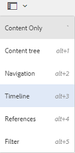
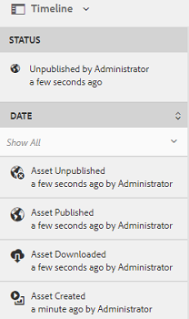

# 时间线中的活动流 {#activity-stream-in-timeline}

此功能在时间轴上显示资源的活动日志。 如果在[!DNL Adobe Experience Manager Assets]中执行以下任何与资产相关的操作，则活动流功能会更新时间线以反映该活动。

以下操作记录在活动流中：

* 创建
* 删除
* 下载（包括演绎版）
* 发布
* 取消发布
* 批准
* 拒绝
* 移动

时间轴中显示的活动日志是从 CRX 中的 `/var/audit/com.day.cq.dam/content/dam` 位置获取的，日志文件就存储在该位置。 此外，当上传新资产或通过[Adobe Asset Link](https://helpx.adobe.com/enterprise/admin-guide.html/enterprise/using/manage-assets-using-adobe-asset-link.ug.html)或[Experience Manager桌面应用程序](https://experienceleague.adobe.com/docs/experience-manager-desktop-app/using/release-notes.html)修改现有资产并签入[!DNL Experience Manager]时，将记录时间轴活动。

>[!NOTE]
>
>临时工作流不会显示在时间轴中，因为不会保存这些工作流的历史记录信息。

要查看活动流，请对资产执行一个或多个操作，选择资产，然后从GlobalNav列表中选择&#x200B;**[!UICONTROL 时间轴]**。

时间轴显示您对资产执行的操作的活动流。

>[!NOTE]
>
>**[!UICONTROL 发布]**&#x200B;和&#x200B;**[!UICONTROL 取消发布]**&#x200B;任务的默认日志存储位置为 `/var/audit/com.day.cq.replication/content`。 对于&#x200B;**[!UICONTROL 移动]**&#x200B;任务，默认位置为 `/var/audit/com.day.cq.wcm.core.page`。
