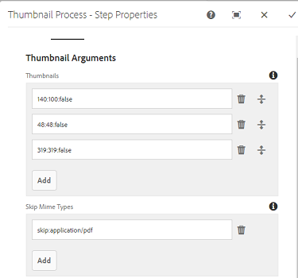
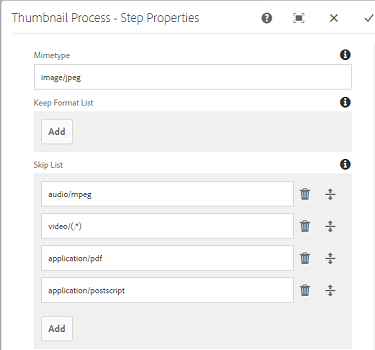
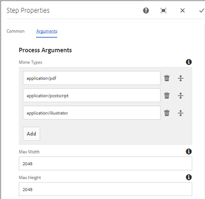
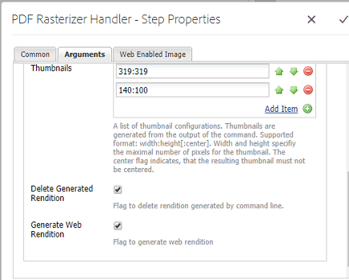
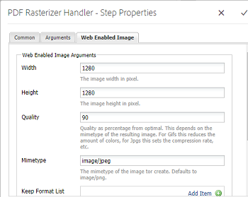
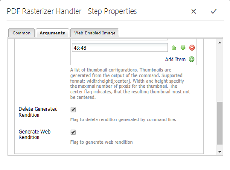
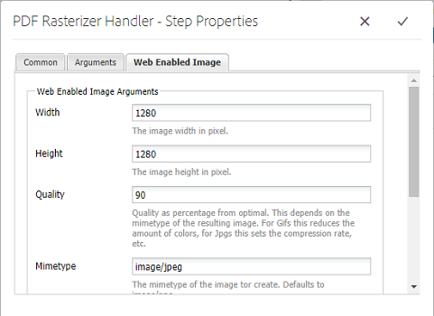

# 使用PDF光栅器 {#using-pdf-rasterizer}

将大型、内容密集型PDF或AI文件上传到[!DNL Adobe Experience Manager Assets]时，默认库可能无法生成准确的输出。 与默认库的输出相比，Adobe的PDF光栅器库可以生成更可靠、更准确的输出。 Adobe建议将PDF光栅器库用于以下场景：

Adobe建议将PDF光栅器库用于：

* 繁重、内容密集的AI文件或PDF文件。
* AI文件和PDF文件，其中包含默认不生成的缩略图。
* 具有Pantone匹配系统(PMS)颜色的AI文件。

与开箱即用输出相比，使用PDF光栅器生成的缩略图和预览质量更好，因此可在各个设备上提供一致的查看体验。 Adobe PDF光栅器库不支持任何色彩空间转换。 无论源文件的色彩空间如何，它始终输出到RGB。

1. 从[Software Distribution](https://experience.adobe.com/#/downloads/content/software-distribution/en/aem.html?package=/content/software-distribution/en/details.html/content/dam/aem/public/adobe/packages/cq650/product/assets/aem-assets-pdf-rasterizer-pkg-4.6.zip)在[!DNL Adobe Experience Manager]部署上安装PDF光栅器包。

   >[!NOTE]
   >
   >PDF光栅器库仅适用于Windows和Linux®。

1. 访问位于`https://[aem_server]:[port]/workflow`的[!DNL Assets]工作流控制台。 打开[!UICONTROL DAM更新资产]工作流。

1. 要防止使用默认方法生成PDF文件和AI文件的缩略图和Web演绎版，请执行以下步骤：

   * 打开&#x200B;**[!UICONTROL 处理缩略图]**&#x200B;步骤，并根据需要在&#x200B;**[!UICONTROL 缩略图]**&#x200B;选项卡下的&#x200B;**[!UICONTROL 跳过MIME类型]**&#x200B;字段中添加`application/pdf`或`application/postscript`。

   

   * 在&#x200B;**[!UICONTROL 启用Web的图像]**&#x200B;选项卡中，根据您的要求，在&#x200B;**[!UICONTROL 跳过列表]**&#x200B;下添加`application/pdf`或`application/postscript`。

   

1. 打开&#x200B;**[!UICONTROL 栅格化PDF/AI图像预览呈现版本]**&#x200B;步骤，并删除要跳过默认生成的预览图像呈现版本的MIME类型。 例如，从&#x200B;**[!UICONTROL MIME类型]**&#x200B;列表中删除MIME类型`application/pdf`、`application/postscript`或`application/illustrator`。

   

1. 将&#x200B;**[!UICONTROL PDF光栅器处理程序]**&#x200B;步骤从侧面板拖到&#x200B;**[!UICONTROL 进程缩略图]**&#x200B;步骤下方。
1. 为&#x200B;**[!UICONTROL PDF光栅器处理程序]**&#x200B;步骤配置以下参数：

   * MIME类型： `application/pdf`或`application/postscript`
   * 命令： `PDFRasterizer -d -s 1280 -t PNG -i ${file}`
   * 添加缩略图大小：319:319、140:100、48:48。 添加自定义缩略图配置（如有必要）。

   `PDFRasterizer`命令的命令行参数可以包含以下内容：

   * `-d`：用于启用文本、矢量图稿和图像的平滑渲染的标志。 创建质量更好的图像。 但是，包含此参数会导致命令运行速度缓慢并增加图像大小。

   * `-s`：最大图像尺寸（高度或宽度）。 每页都将转换为DPI。 如果页面大小不同，则每个页面可能会按不同的数量进行缩放。 默认值为实际页面大小。

   * `-t`：输出图像类型。 有效类型为JPEG、PNG、GIF和BMP。 默认值为JPEG。

   * `-i`：输入PDF的路径。 它是必需参数。

   * `-h`：帮助

1. 要删除中间格式副本，请选择&#x200B;**[!UICONTROL 删除生成的格式副本]**。
1. 要让PDF光栅器生成Web呈现形式，请选择&#x200B;**[!UICONTROL 生成Web呈现形式]**。

   

1. 在&#x200B;**[!UICONTROL 启用Web的图像]**&#x200B;选项卡中指定设置。

   

1. 保存工作流。
1. 要使PDF光栅器能够使用PDF Libraries处理PDF页面，请从[!UICONTROL 工作流]控制台打开&#x200B;**[!UICONTROL DAM处理子资产]**&#x200B;模型。
1. 从侧面板中，将PDF光栅器处理程序步骤拖动到&#x200B;**[!UICONTROL 创建支持Web的图像演绎版]**&#x200B;步骤下。
1. 为&#x200B;**[!UICONTROL PDF光栅器处理程序]**&#x200B;步骤配置以下参数：

   * MIME类型： `application/pdf`或`application/postscript`
   * 命令： `PDFRasterizer -d -s 1280 -t PNG -i ${file}`
   * 添加缩略图大小： `319:319`、`140:100`、`48:48`。 根据需要添加自定义缩略图配置。

   `PDFRasterizer`命令的命令行参数可以包含以下内容：

   * `-d`：用于启用文本、矢量图稿和图像的平滑渲染的标志。 创建质量更好的图像。 但是，包含此参数会导致命令运行速度缓慢并增加图像大小。

   * `-s`：最大图像尺寸（高度或宽度）。 每页都将转换为DPI。 如果页面大小不同，则每个页面可能会按不同的数量进行缩放。 默认值为实际页面大小。

   * `-t`：输出图像类型。 有效类型为JPEG、PNG、GIF和BMP。 默认值为JPEG。

   * `-i`：输入PDF的路径。 它是必需参数。

   * `-h`：帮助

1. 要删除中间格式副本，请选择&#x200B;**[!UICONTROL 删除生成的格式副本]**。
1. 要让PDF光栅器生成Web呈现形式，请选择&#x200B;**[!UICONTROL 生成Web呈现形式]**。

   

1. 在&#x200B;**[!UICONTROL 启用Web的图像]**&#x200B;选项卡中指定设置。

   

1. 保存工作流。
1. 将PDF文件或AI文件上传到[!DNL Experience Manager Assets]。 PDF光栅器会为文件生成缩略图和Web演绎版。
