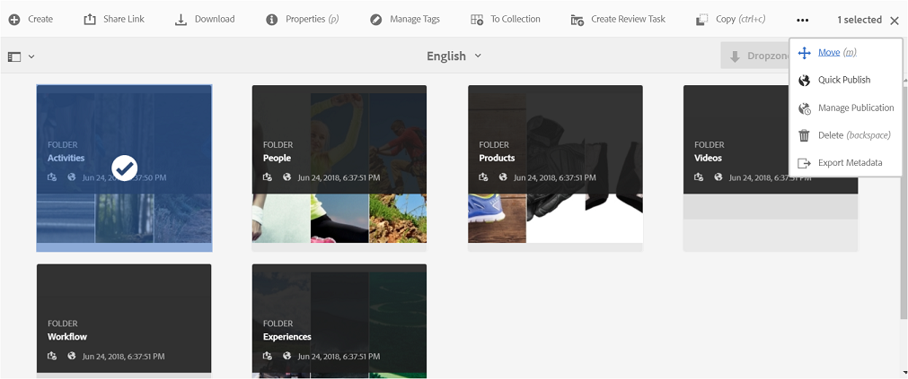
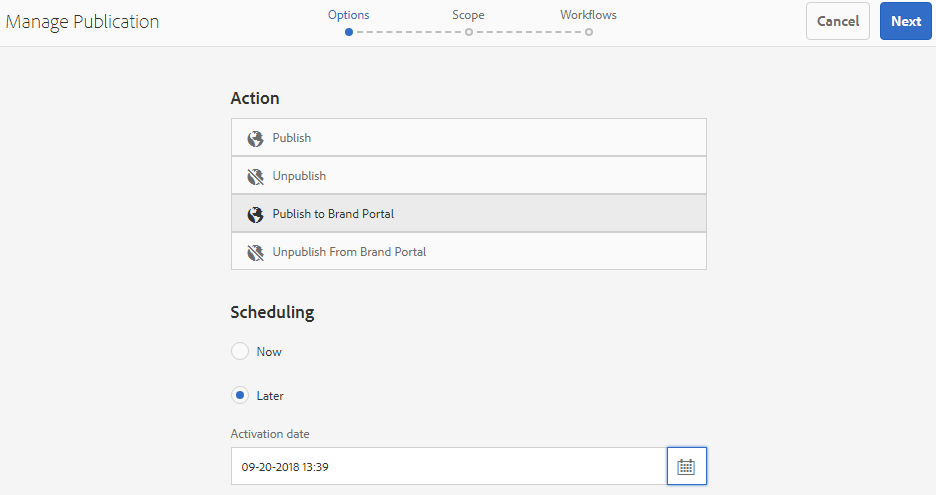
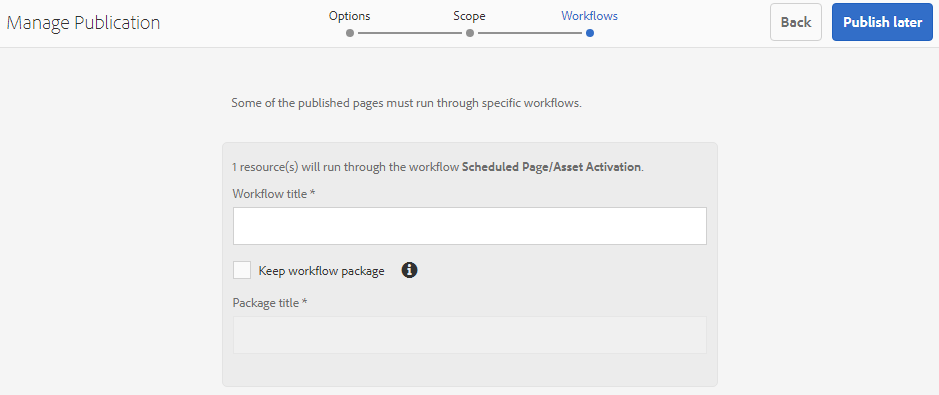
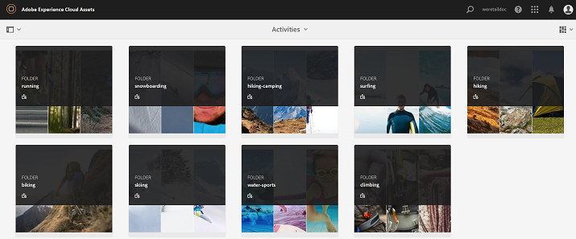
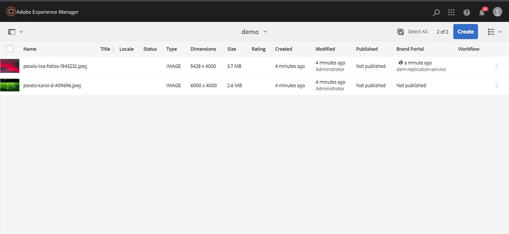

# 将资源发布到Brand Portal {#publish-assets-to-brand-portal}

| 版本 | 文章链接 |
| -------- | ---------------------------- |
| AEM as a Cloud Service | [单击此处](https://experienceleague.adobe.com/docs/experience-manager-cloud-service/content/assets/brand-portal/publish-to-brand-portal.html?lang=zh-Hans) |
| AEM 6.5 | 本文 |

作为Adobe Experience Manager (AEM) Assets管理员，您可以将资产和文件夹发布到AEM Assets Brand Portal实例（或安排在稍后的日期/时间执行发布工作流）。 但是，您必须首先使用 Brand Portal 配置 AEM Assets。 有关详细信息，请参阅[使用 Brand Portal 配置 AEM Assets](/help/assets/configure-aem-assets-with-brand-portal.md)。

复制成功后，您可以将资源、文件夹和收藏集发布到Brand Portal。 要将资源发布到Brand Portal，请执行以下步骤：

>[!NOTE]
>
>Adobe 建议实施错峰发布，最好在非高峰时段发布，这样 AEM 作者就不会占用过多的资源。

1. 从Assets控制台中，选择要发布的资源/文件夹，然后单击工具栏中的&#x200B;**[!UICONTROL 快速发布]**&#x200B;选项。

   或者，选择要发布到Brand Portal的资源。

   

1. 要将资源发布到Brand Portal，可以使用以下两个选项：
   * [立即发布资源](#publish-to-bp-now)
   * [稍后发布资产](#publish-to-bp-now)

## 立即发布资产 {#publish-to-bp-now}

要将选定资产发布到 Brand Portal，请执行以下任一操作：

* 在工具栏中，选择&#x200B;**[!UICONTROL 快速发布]**。 然后从菜单中选择&#x200B;**[!UICONTROL 发布到Brand Portal]**。

* 在工具栏中，选择&#x200B;**[!UICONTROL 管理发布]**。

  1. 然后从&#x200B;**[!UICONTROL 操作]**&#x200B;中选择&#x200B;**[!UICONTROL 发布到Brand Portal]**，并从&#x200B;**[!UICONTROL 计划]**&#x200B;中选择&#x200B;**[!UICONTROL 立即]**。 单击&#x200B;**[!UICONTROL 下一步]**。

  2. 在&#x200B;**[!UICONTROL 范围]**&#x200B;内，确认您的选择，然后单击&#x200B;**[!UICONTROL 发布到Brand Portal]**。

此时将显示一条消息，表明资产已排队等候发布到 Brand Portal。 登录到 Brand Portal 界面可查看已发布的资产。

## 稍后发布资产 {#publish-to-bp-later}

要计划在稍后的日期或时间将资产发布到 Brand Portal，请执行以下操作：

1. 选择要发布的资产/文件夹后，从顶部的工具栏中选择&#x200B;**[!UICONTROL 管理发布]**。

1. 在&#x200B;**[!UICONTROL 管理发布]**&#x200B;页面上，从&#x200B;**[!UICONTROL 操作]**&#x200B;中选择&#x200B;**[!UICONTROL 发布到Brand Portal]**，并从&#x200B;**[!UICONTROL 计划]**&#x200B;中选择&#x200B;**[!UICONTROL 稍后]**。

   

1. 选择&#x200B;**[!UICONTROL 激活日期]**，并指定时间。 单击&#x200B;**[!UICONTROL 下一步]**。

1. 选择&#x200B;**激活日期**，并指定时间。 单击&#x200B;**下一步**。

1. 在&#x200B;**[!UICONTROL 工作流]**&#x200B;中指定&#x200B;**[!UICONTROL 工作流标题]**。 单击&#x200B;**[!UICONTROL 稍后发布]**。

   

现在，登录到Brand Portal以查看发布的资源在Brand Portal界面上是否可用。

## 查看发布到Brand Portal的文件或文件夹 {#view-published-file-folder}

1. 登录 Brand Portal 界面可查看已发布的资产（取决于您的计划日期或时间）。

   

1. 切换到列表视图以查看资源的当前发布状态。

<!--2. On the [Asset Reports page](#https://experienceleague.adobe.com/en/docs/experience-manager-cloud-service/content/assets/admin/asset-reports), you can see the current state of the report job, for example, Success, Failed, Queued, or Scheduled.-->

