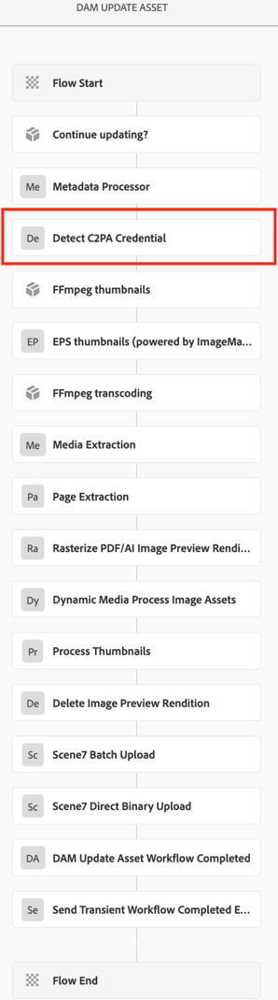
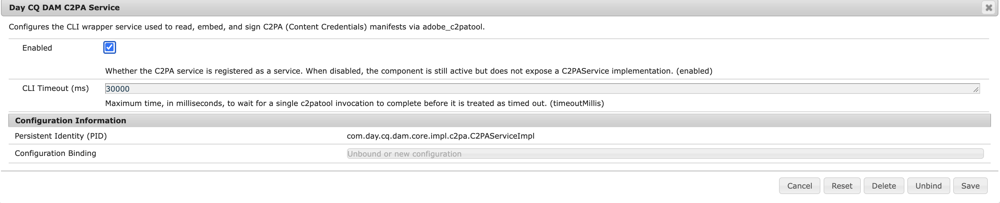

# [!DNL Experience Manager Assets]中的C2PA元数据 {#c2pa-metadata}

品牌对内容透明度、AI 来源披露以及防止资产被篡改的关注程度空前提高。 Adobe 的 Content Authenticity Initiative (CAI) 构建了符合[内容来源和真实性联盟](https://c2pa.org/specifications/specifications/2.2/specs/C2PA_Specification.html) (C2PA) 技术标准的工具。 C2PA元数据是一种新型的可篡改元数据，可帮助查看者了解内容的谱系并确保品牌资产的完整性。 Content Credentials 可包含多种溯源数据，深入呈现数字资产的历史信息。

这些信息包括：

* **颁发者或签名者：**&#x200B;有关为资产颁发数字签名的实体或公司的信息。
* **问题日期：**&#x200B;将C2PA元数据应用于资源的日期。
* **过程：**&#x200B;对资产进行任何编辑或更改的记录。
* **设备详细信息：**&#x200B;关于在创建或编辑资产时使用的应用程序或设备的信息。
* **使用的AI工具：**&#x200B;如果使用创作AI编辑或创建资产，则包含使用的模型的名称。
* **其他相关信息：**&#x200B;提供更多有关资产历史记录上下文的其他数据。

有关资产历史记录的详细信息，请参阅[验证](https://contentcredentials.org/verify)。

[!DNL Adobe Experience Manager Assets]在您上传或更新资产时检测C2PA元数据，在[!DNL Assets]用户界面中标记这些资产，并在[!DNL Experience Manager]生成的演绎版中保持Gen AI公开不变。 每当[!DNL Experience Manager]创建或修改Gen AI资源的演绎版（例如缩略图、Web演绎版、带水印的副本或视频转码）时，[!DNL Experience Manager]都会使用引用原始资源作为其父资源的新C2PA元数据来标记该演绎版。 您下载、发布或共享的演绎版会保留其原始资料。

## 先决条件 {#Prerequisites}

C2PA元数据支持需要[!DNL Adobe Experience Manager] 6.5服务包。 在Service Pack 6.5.25.0上，安装[AEM 6.5 SP25 - C2PA GenAI合规性修补程序](https://experience.adobe.com/#/downloads/content/software-distribution/en/aem.html?package=/content/software-distribution/en/details.html/content/dam/aem/public/adobe/packages/cq650/hotfix/cq-6.5.0-hotfix-ASSETS-75868-SP25-1.0.zip)。

## 支持的格式和平台 {#supported-formats}

### 格式 {#formats}

[!DNL Experience Manager]以[C2PA规范](https://c2pa.org/specifications/specifications/2.2/specs/C2PA_Specification.html)支持嵌入式清单的格式对格式副本进行签名。

| 类型 | 格式 | MIME 类型 |
|---|---|---|
| 图像 | JPEG、PNG、GIF、TIFF、DNG、WebP、JPEG XL、AVIF、HEIC/HEIF、SVG | `image/jpeg`, `image/png`, `image/gif`, `image/tiff`, `image/x-adobe-dng`, `image/webp`, `image/jxl`, `image/avif`, `image/heic`, `image/heif`, `image/svg+xml` |
| 视频 | MP4、MOV、AVI | `video/mp4`, `video/quicktime`, `video/x-msvideo` |
| 音频 | MP3、M4A、WAV、FLAC | `audio/mpeg`, `audio/mp4`, `audio/wav`, `audio/flac` |

[!DNL Experience Manager]还可以识别常见别名，如`image/jpg`、`image/pjpeg`、`image/x-png`和`video/mov`。 [!DNL Experience Manager]检查每个上载的资产是否有清单，而不管文件格式如何。 其他格式（如PSD或EPS）的演绎版未经过签名。

### 平台 {#platforms}

C2PA元数据支持依赖于`cq-dam-core`捆绑包中提供的本机C2PA组件，每个受支持的平台具有一个内部版本。 当服务启动时，[!DNL Experience Manager]将您平台（`adobe_c2patool`或Windows上的`adobe_c2patool.exe`）的生成提取到捆绑包的私有数据文件夹，检查SHA-256校验和，并将其作为单独的进程运行。 您无需安装任何内容或更改`PATH`。

| 操作系统 | 架构 |
|---|---|
| Linux（glibc 2.28或更高版本，包括Red Hat Enterprise Linux 8） | `x86_64`, `aarch64` |
| macOS | `x86_64`，`aarch64` （Apple硅） |
| Windows | `x86_64` |

这在[!DNL Adobe Managed Services]和内部部署中的工作方式相同。 确保[!DNL Experience Manager]进程可以启动此可执行文件。 如果您使用`noexec`装载、防病毒或端点安全软件，请允许`adobe_c2patool`从`crx-quickstart`文件夹中运行。 否则，无法启动C2PA元数据支持。

## C2PA元数据的工作方式 {#how-c2pa-metadata-works}

C2PA元数据支持分为两部分：在上传或更新资产时进行检测，以及每当[!DNL Experience Manager]生成或修改演绎版时重新签名。

### 工作流配置 {#workflow}

在[检测C2PA元数据](#detect)中显示的&#x200B;**[!UICONTROL 检测C2PA凭据]**&#x200B;步骤是默认&#x200B;**[!UICONTROL DAM更新资产]**&#x200B;工作流模型的一部分。 如果您使用该模型的自定义副本，请自行添加该步骤：

1. 在[!DNL Experience Manager]界面中，导航到&#x200B;**[!UICONTROL 工具]** > **[!UICONTROL 工作流]** > **[!UICONTROL 模型]**，并在 **[!UICONTROL 编辑]**&#x200B;模式下打开模型。
1. 在&#x200B;**[!UICONTROL 元数据处理器]**&#x200B;之后添加&#x200B;**[!UICONTROL 检测C2PA凭据]**&#x200B;步骤，然后任何步骤都生成演绎版。
1. 选择&#x200B;**[!UICONTROL 同步]**&#x200B;以保存模型。

仅当已在资源上运行检测时，演绎版步骤才会对其输出进行签名。 如果检测在它们之后运行，则它们的演绎版将保持未签名状态，直到工作流再次运行。

### 检测C2PA元数据 {#detect}

**[!UICONTROL DAM更新资产]**&#x200B;工作流包括在&#x200B;**[!UICONTROL 元数据处理器]**&#x200B;步骤之后运行的&#x200B;**[!UICONTROL 检测C2PA凭据]**&#x200B;步骤，如下图所示。 它读取资产的原始二进制文件，并将结果记录在资产的元数据节点`jcr:content/metadata`中。



下表列出了C2PA元数据工作流中的关键元数据属性。

| 属性 | 类型 | 描述 |
|---|---|---|
| `dam:hasC2PAManifest` | `boolean` | `true`，如果原始二进制文件具有嵌入的C2PA清单。 它总是写的。 |
| `dam:isAiGenerated` | `boolean` | `true`，如果清单将资产纳入到Gen AI标签的作用域中。 仅当存在清单时才写入它。 |
| `dam:c2paValidationState` | `string` | 它描述了清单的验证状态： `TRUSTED`、`VALID`、`INVALID`或`UNKNOWN`。 仅当存在清单时才写入它。 |

当清单存在时，[!DNL Experience Manager]还会将其存储为`c2pa-manifest.json`演绎版(`application/json`)。

如果将原始资产替换为不含清单的二进制文件，则下次工作流运行会将`dam:hasC2PAManifest`设置为`false`并删除`dam:isAiGenerated`、`dam:c2paValidationState`和`c2pa-manifest.json`呈现版本。

>[!NOTE]
>
>检测失败不会阻止资产摄取。 如果读取清单超时或失败，[!DNL Experience Manager]将记录该错误，保留元数据不变，然后继续执行工作流的其余部分。

### 在[!DNL Assets]用户界面中查看C2PA元数据 {#view-c2pa-metadata}

带有C2PA元数据的Assets在[!DNL Assets]用户界面中显示&#x200B;**cr** （C2PA元数据）标记。 导航到&#x200B;**[!UICONTROL Assets]** > **[!UICONTROL 文件]**，然后在的左下角查找徽章：

* **[!UICONTROL 卡片视图]**&#x200B;中的资产缩略图。
* **[!UICONTROL 列视图]**&#x200B;中的资产缩略图。 选择资源以显示其缩略图。
* 资源详细信息页面的预览区域。

下图中显示的&#x200B;**cr**&#x200B;徽章指示资产是否包含C2PA元数据。 它不显示清单本身。 要查看完整的清单，请下载该资源，然后在[验证](https://contentcredentials.org/verify)中将其打开。


[!DNL Experience Manager]将检测到的清单存储为资源上的`c2pa-manifest.json`演绎版。 此演绎版为内部版本。 它不会出现在资源详细信息页面的&#x200B;**[!UICONTROL 呈现版本]**&#x200B;面板中或呈现版本选择器中。

### 签名演绎版 {#sign-renditions}

演绎版是新的二进制文件，因此嵌入到原始资产中的清单不会涵盖它。 为了保持Gen AI公开完整，[!DNL Experience Manager]将每个符合条件的演绎版签名作为生成演绎版过程的最后一步。 新的C2PA元数据：

* 将原始资产引用为其&#x200B;**父**&#x200B;成分。
* 记录如何从C2PA操作`c2pa.resized`、`c2pa.transcoded`或`c2pa.edited`之一的原始资源派生演绎版。
* 将`Adobe Experience Manager`命名为软件代理。

仅当以下所有条件均为`true`时，[!DNL Experience Manager]才签署演绎版：

* 源资源的`dam:isAiGenerated`设置为`true`。 带有清单但未通过AI生成的Assets仍显示&#x200B;**cr**&#x200B;徽章，但[!DNL Experience Manager]没有对其演绎版重新签名。
* 源清单可读，其验证状态不是`INVALID`。 [!DNL Experience Manager]绝不会将新签名链接到验证失败的清单，例如，在资产被篡改之后。
* 节目格式支持嵌入的C2PA清单。 有关详细信息，请参阅[支持的格式](#supported-formats)。 [!DNL Experience Manager]跳过不支持的格式且没有错误。

[检测C2PA元数据](#detect)中显示的&#x200B;**[!UICONTROL DAM更新资产工作流已完成]**&#x200B;工作流的以下步骤对其输出签名。

| 工作流步骤 | 已签署的演绎版 | 已记录C2PA操作 |
|---|---|---|
| **[!UICONTROL 处理缩略图]** | 缩略图演绎版和启用Web的图像。 | 格式更改时`c2pa.resized`和`c2pa.transcoded`。 |
| **[!UICONTROL EPS缩略图（由ImageMagick提供支持）]** | 主输出、派生缩略图和Web呈现形式。 | `c2pa.resized`、`c2pa.transcoded`或`c2pa.edited` |
| **[!UICONTROL FFmpeg缩略图]** | 视频海报帧和缩略图。 | `c2pa.resized` 和 `c2pa.transcoded` |
| **[!UICONTROL FFmpeg转码]** | 视频编码。 | `c2pa.transcoded` |
| **[!UICONTROL 栅格化PDF/AI图像预览呈现版本]** | 预览节目。 (`cqdam.preview.png`) | `c2pa.transcoded` |

当您在&#x200B;**[!UICONTROL DAM更新资产工作流已完成]**&#x200B;工作流、另一个工作流或自定义工作流模型中使用以下工作流进程时，这些进程也会对其输出签名。 在工作流步骤的&#x200B;**[!UICONTROL 进程缩略图]**&#x200B;列表中选择它们，如[检测C2PA元数据](#detect)中所示。

| 工作流过程 | 已签署的演绎版 | 已记录C2PA操作 |
|---|---|---|
| **[!UICONTROL 创建缩略图]** | 缩略图演绎版。 | 格式更改时`c2pa.resized`和`c2pa.transcoded`。 |
| **[!UICONTROL 创建启用Web的图像]** | Web呈现版本。 | 格式更改时`c2pa.resized`和`c2pa.transcoded`。 |
| **[!UICONTROL 命令行]**，例如，带有[!DNL ImageMagick] | 主输出、派生缩略图和Web呈现形式。 | `c2pa.resized`、`c2pa.transcoded`或`c2pa.edited` |
| **[!UICONTROL 图像水印进程]** | 带水印的演绎版，或带水印的原始演绎版。 有关详细信息，请参阅[为您的资产添加水印](/help/assets/watermarking.md)。 | `c2pa.edited` |
| **[!UICONTROL 创建视频脚本]** | 情节提要关键帧。 | `c2pa.transcoded` |
| **[!UICONTROL XMP写回]** | 在元数据回写后的原始演绎版。 有关详细信息，请参阅[XMP对演绎版的写回](/help/assets/xmp-writeback.md)。 | `c2pa.edited` |

### 在XMP写回期间保护原始二进制文件 {#xmp-writeback}

XMP写回会重写原始二进制文件，这会破坏其嵌入的清单。 对于将`dam:hasC2PAManifest`设置为`true`的资源，[!DNL Experience Manager]将更改&#x200B;**[!UICONTROL DAM元数据写回]**&#x200B;工作流的&#x200B;**[!UICONTROL XMP写回进程]**&#x200B;步骤的行为，如下所示：

* **Gen AI资源** （`dam:isAiGenerated`是`true`）： [!DNL Experience Manager]写入XMP，然后重新签名原始二进制文件，并将预写二进制文件作为父级。 它将写回和新签名保存在一起。 如果重新签名失败，它将放弃这两个步骤，并且无法执行此步骤。
* **携带清单的其他资源**： [!DNL Experience Manager]将跳过XMP写回并记录原因。 原始二进制文件及其清单保持不变。

### 签名模式 {#signing-mode}

[!DNL Experience Manager]在生成演绎版的实例上本地签名演绎版，并使用它自己生成的临时自签名证书。 签名不需要网络访问，也不需要证书或私钥配置。

>[!NOTE]
>
>您无法配置自己的签名证书。 诸如[验证](https://contentcredentials.org/verify)之类的验证器显示了演绎版的Gen AI披露以及与原始演绎版的链接，但并未将您的组织标识为签名者。

## 配置C2PA元数据 {#configure}

默认情况下启用C2PA元数据支持。 您无需安装或配置任何内容。

### OSGi配置 {#osgi-configuration}

要更改默认配置，请在`https://[aem_server]:[port]/system/console/configMgr`的配置管理器中配置&#x200B;**[!UICONTROL Day CQ DAM C2PA服务]** (PID `com.day.cq.dam.core.impl.c2pa.C2PAServiceImpl`)，如下图所示，或将OSGi配置添加到您的项目中。 有关详细信息，请参阅[配置OSGi](/help/sites-deploying/configuring-osgi.md)。



下表列出了项目OSGi配置中的属性。

| 属性 | Configuration Manager中的名称 | 默认 | 描述 |
|---|---|---|---|
| `enabled` | **[!UICONTROL 已启用]** | `true` | 打开或关闭C2PA元数据支持。 关闭时，[!DNL Experience Manager]不会检测到清单，也不会签署呈现版本。 |
| `timeoutMillis` | **[!UICONTROL CLI超时（毫秒）]** | `30000` | 指定[!DNL Experience Manager]在处理文件超时之前等待该文件单次读取或签名操作的最长时间（以毫秒为单位）。 请为大型视频或高分辨率图像文件提高此值。 |

例如，在`/apps/<your-project>/config/com.day.cq.dam.core.impl.c2pa.C2PAServiceImpl.config`处添加OSGi配置。

```text
enabled=B"true"
timeoutMillis=L"60000"
```

### 关闭C2PA元数据支持 {#disable}

在[OSGi配置](#osgi-configuration)中显示的&#x200B;**[!UICONTROL Day CQ DAM C2PA服务]**&#x200B;配置中，禁用&#x200B;**[!UICONTROL 已启用]**&#x200B;选项，然后保存更改。 更改立即生效，无需重新启动：

* 在[检测C2PA元数据](#detect)中显示的&#x200B;**[!UICONTROL 检测C2PA凭据]**&#x200B;步骤变得不可操作。
* 工作流步骤无需签名即可创建演绎版。
* Assets以前处理过，保留其`dam:hasC2PAManifest`属性，并且仍显示&#x200B;**cr**&#x200B;徽章。

>[!CAUTION]
>
>禁用&#x200B;**[!UICONTROL Enabled]**&#x200B;选项后，Gen AI资源的演绎版不包含C2PA元数据。 如果要遵守Gen AI公开规定，请启用&#x200B;**[!UICONTROL 已启用]**&#x200B;选项。

## 自定义处理管道 {#customize}

要在&#x200B;**[!UICONTROL DAM更新资产]**&#x200B;中添加、删除或重新排序步骤，并且仍保持Gen AI公开不变，请遵循以下规则：

* **首先运行检测。** 在创建或修改演绎版的每个步骤之前保持&#x200B;**[!UICONTROL 检测C2PA凭据]**。
* **最后签名。** 签名后对二进制文件所做的任何更改都会使其签名失效。 请勿在签署演绎版的步骤之后运行修改演绎版的步骤。
* **使用签名步骤。** [签名演绎版](#sign-renditions)中列出的内置步骤对其输出进行签名。 您通过&#x200B;**[!UICONTROL 命令行]**&#x200B;进程之外的任何其他进程运行的自定义步骤和第三方工具不会对其输出进行签名，除非明确添加签名。 有关详细信息，请参阅[使用媒体处理程序和工作流处理资源](/help/assets/media-handlers.md)。
* **请勿就地修改原始文档**，除非步骤重新签名，如&#x200B;**[!UICONTROL XMP写回]**&#x200B;和&#x200B;**[!UICONTROL 图像水印进程]**&#x200B;所做的那样。

### 从自定义工作流步骤对演绎版进行签名 {#custom-step}

生成演绎版的自定义工作流步骤可以通过`com.day.cq.dam.api.c2pa.C2PASigner` OSGi服务对其进行签名。 它应用与内置步骤相同的资格规则，但将结果报告为`C2PASigningOutcome`。

```java
import java.util.Collections;

import org.osgi.service.component.annotations.Reference;
import org.osgi.service.component.annotations.ReferenceCardinality;
import org.osgi.service.component.annotations.ReferencePolicy;

import com.day.cq.dam.api.Asset;
import com.day.cq.dam.api.Rendition;
import com.day.cq.dam.api.c2pa.C2PAAction;
import com.day.cq.dam.api.c2pa.C2PAConstants;
import com.day.cq.dam.api.c2pa.C2PASigner;
import com.day.cq.dam.api.c2pa.C2PASigningOutcome;

// Inside your WorkflowProcess implementation:

@Reference(cardinality = ReferenceCardinality.OPTIONAL, policy = ReferencePolicy.DYNAMIC)
private volatile C2PASigner c2paSigner;

private void signRendition(Asset asset, Rendition rendition) {
    C2PASigner signer = c2paSigner;
    if (signer == null) {
        return;
    }
    C2PASigningOutcome outcome = signer.signIfEligible(asset, rendition,
            Collections.singletonList(
                    new C2PAAction(C2PAConstants.ACTION_RESIZED, C2PAConstants.SOFTWARE_AGENT, null)));
    if (outcome == C2PASigningOutcome.FAILED) {
        // Log, retry, or alert an operator.
    }
}
```

仅在步骤完成编写呈现版本后调用`signIfEligible`。 OSGi服务提供下表所列的方法。

| 方法 | 使用它可以 |
|---|---|
| `signIfEligible(Asset, Rendition, List<C2PAAction>)` | 签署一个新演绎版，并将源资产作为其父资产。 |
| `signIfEligible(Asset, Map<Rendition, List<C2PAAction>>)` | 对从同一资源派生的多个演绎版进行签名。 此方法读取一次源清单。 |
| `captureResignState(Asset)` | 在步骤就地修改原始资产之前，请拍摄原始资产的图像。 如果资产不合格，则此方法返回`null`。 |
| `resign(Asset, Rendition, List<C2PAAction>)` | 就地更改后，重新签署原始资产，图像作为其父级。 |
| `discardResignState(Rendition)` | 放置您拍摄的图像，但不使用，例如，因为更改失败。 |

下表提及了`C2PASigningOutcome`的值。

| 结果 | 描述 |
|---|---|
| `SIGNED` | [!DNL Experience Manager]已签署演绎版。 |
| `SKIPPED_SOURCE_NOT_AI_GENERATED` | 源资产不会标记为AI生成的资产。 |
| `SKIPPED_FORMAT_NOT_ELIGIBLE` | 节目格式不支持嵌入的C2PA清单。 |
| `SKIPPED_MANIFEST_UNREADABLE` | [!DNL Experience Manager]在源资产上未找到清单。 |
| `SKIPPED_MANIFEST_NOT_VALID` | 源清单验证失败。 |
| `SKIPPED_SERVICE_UNAVAILABLE` | C2PA元数据支持已关闭或不可用。 |
| `FAILED` | 读取源清单或签署演绎版失败。 |

要在生成昂贵的演绎版之前检查资格，请调用`C2PASupportedFormats.isEligible(...)`。

## 疑难解答 {#troubleshooting}

进行故障排除时，请在&#x200B;**[!UICONTROL Apache Sling日志记录器配置]**&#x200B;中将以下日志记录器设置为`DEBUG`。

* `com.day.cq.dam.core.impl.c2pa`：提取本机C2PA组件、清单读取和签名。
* `com.day.cq.dam.core.process.DetectC2PACredentialProcess`：检测。

| 症状 | 可能的原因 | 解决方法 |
|---|---|---|
| 没有资产显示&#x200B;**cr**&#x200B;徽章。 | C2PA元数据支持已关闭，或您的工作流模型不包含检测步骤。 | 检查是否已在&#x200B;**[!UICONTROL Day CQ DAM C2PA服务]**&#x200B;配置中启用&#x200B;**[!UICONTROL 已启用]**，并且您的&#x200B;**[!UICONTROL DAM更新资产]**&#x200B;模型包含&#x200B;**[!UICONTROL 检测C2PA凭据]**。 |
| 您知道的资产具有清单，但未显示徽章。 | 该资产是在功能可用之前上传的。 | 再次对资产运行&#x200B;**[!UICONTROL DAM更新资产]**&#x200B;工作流，例如，从&#x200B;**[!UICONTROL 时间轴]** > **[!UICONTROL 启动工作流]**。 |
| 服务无法启动。 错误日志报告无法提取`adobe_c2patool`或将其标记为可执行文件。 | 操作系统或体系结构不存在二进制文件，或者文件系统阻止可执行文件。 | 使用支持的平台。 允许[!DNL Experience Manager]进程从其`crx-quickstart`文件夹运行可执行文件。 |
| 错误日志报告`GLIBC_2.xx not found`。 | Linux主机运行的是2.28以前的glibc版本。 | 升级主机操作系统。 |
| 检测或签名超时。 | 大型文件需要的时间比默认的30秒超时更长。 | 引发&#x200B;**[!UICONTROL CLI超时（毫秒）]**。 |
| Gen AI资产的演绎版未签名。 | 不支持该格式，清单为`INVALID`，或者在演绎版步骤之后运行检测。 | 检查`dam:c2paValidationState`和演绎版格式。 将&#x200B;**[!UICONTROL 检测C2PA凭据]**&#x200B;移动到节目步骤之前。 |
| XMP写回不会更新资源。 | 该资产带有清单，但不是通过AI生成的，因此[!DNL Experience Manager]保持其原始不变。 | 这是正常行为。 有关详细信息，请参阅[在XMP写回期间保护原始版本](#xmp-writeback)。 |

## 限制 {#limitations}

* [!DNL Assets]用户界面只显示C2PA元数据是否存在。 它没有用于清单详细信息的面板。
* [!DNL Experience Manager]仅为通过AI生成的资源重新签名演绎版。 创建包含清单的其他资源的演绎版时不会使用C2PA元数据。
* [!DNL Experience Manager]个签名包含临时自签名证书。 不支持自定义或特定于组织的签名证书。


>[!MORELIKETHIS]
>
>*  [!DNL Experience Manager as a Cloud Service]&#x200B;[&#128279;](https://experienceleague.adobe.com/en/docs/experience-manager-cloud-service/content/assets/assets-view/c2pa-metadata-assets-view)的Assets视图中的C2PA元数据
>*  [!DNL Experience Manager Assets Essentials]&#x200B;[&#128279;](https://experienceleague.adobe.com/en/docs/experience-manager-assets-essentials/help/content-credentials)中的C2PA元数据
>*  [!DNL Dynamic Media]&#x200B;[&#128279;](https://experienceleague.adobe.com/en/docs/experience-manager-cloud-service/content/assets/dynamicmedia/dynamic-media-open-apis/c2pa-metadata)中的C2PA元数据
>* [XMP写回到演绎版](/help/assets/xmp-writeback.md)
>* [为您的资产添加水印](/help/assets/watermarking.md)
>* [Content Authenticity Initiative](https://contentauthenticity.org/)
>* [验证](https://contentcredentials.org/verify)
