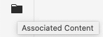
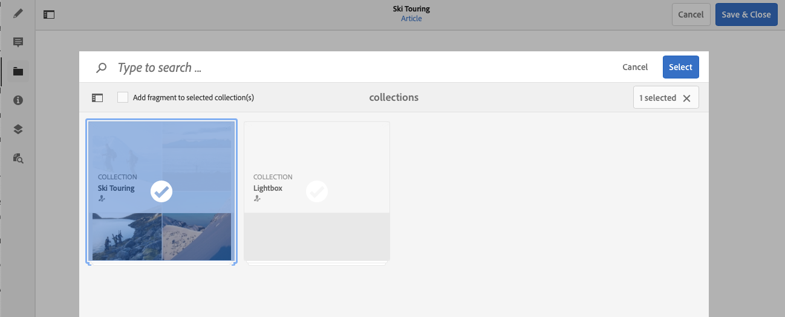
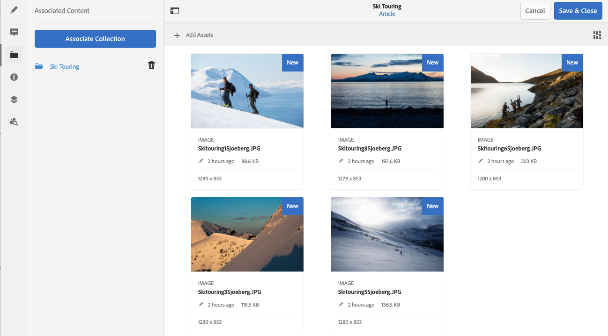

# 关联的内容{#associated-content}

AEM的关联内容功能提供了连接，以便在将资产添加到内容页面时，可以（可选）将资产与片段一起使用。 这为Headless内容投放提供了灵活性，方法是[在页面上使用内容片段时提供要访问的一系列资产，](/help/sites-authoring/content-fragments.md#using-associated-content)，同时还有助于减少搜索适当资产所需的时间。 可以使用内容片段编辑器配置任何关联的内容。

## 添加关联内容 {#adding-associated-content}

>[!NOTE]
>
>可以通过多种方法向片段和/或页面中添加[可视资源（例如图像）](/help/assets/content-fragments/content-fragments.md#fragments-with-visual-assets)。

若要建立关联，您首先需要[将媒体资产添加到收藏集](/help/assets/manage-collections.md)。 完成该操作后，您可以：

1. 打开片段，然后从侧面板中选择&#x200B;**关联的内容**。

   

1. 根据是否已关联任何收藏集，选择以下任一选项：

   * **关联内容** – 这将是第一个关联的集合
   * **关联集合** — 已配置的关联集合

1. 选择所需的集合。

   您可以选择将片段本身添加到选定的收藏集中；这有助于跟踪。

   

1. 确认（使用&#x200B;**选择**）。 收藏集将列为关联的。

   

## 编辑关联内容 {#editing-associated-content}

关联收藏集后，您可以：

* **删除**&#x200B;关联。
* **添加资源**&#x200B;到收藏集。
* 选择资产以执行进一步操作。
* 编辑资产。
