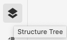
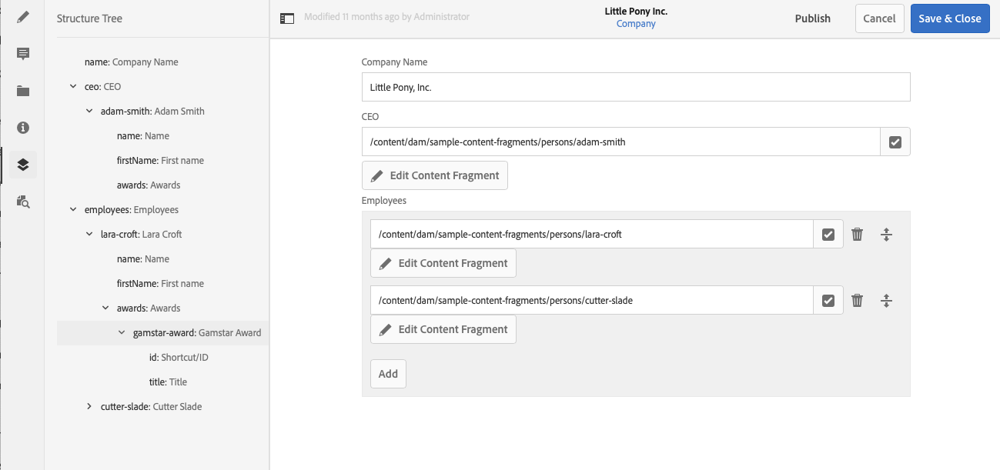

# 内容片段结构树 {#content-fragment-structure-tree}

使用 AEM 中内容片段编辑器的结构树功能，更好地了解您的 headless 内容。

在内容片段编辑器中，您可以选择结构树图标：

这将在左侧窗格中打开片段结构的表示形式。 通过此选项，您可以导航到引用的片段。 选择引用会打开该片段进行编辑。

>[!NOTE]
>
>使用主面板中的痕迹导航，您可以导航回起始点。

