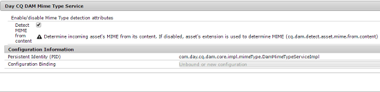

# 使用[!DNL Apache Tika]检测MIME类型的资源 {#detecting-mime-type-of-assets-using-apache-tika}

通常，[!DNL Adobe Experience Manager Assets]会检测您从其文件扩展名上传的资源的MIME类型。

如果您使用[!DNL Apache Tika]上传资产，在上传操作期间，[!DNL Assets]会从内容流中检测其MIME类型，而不是文件扩展名。

默认情况下，此功能处于禁用状态。 要启用该功能，请从[!UICONTROL 配置管理器]配置&#x200B;**[!UICONTROL Day CQ DAM Mime Type]**&#x200B;服务。

>[!NOTE]
>
>使用[!DNL Apache Tika]库的MIME类型检测是一项资源密集型操作。

1. 要打开Configuration Manager Web控制台，请访问`https://[aem_server]:[port]/system/console/configMgr`。

1. 从服务列表中，找到&#x200B;**[!UICONTROL Day CQ DAM Mime类型服务]**，然后单击&#x200B;**[!UICONTROL 编辑]**。

1. 选择&#x200B;**[!UICONTROL 从内容检测MIME]**&#x200B;选项可启用已上传资源的解析，以确定其MIME类型，同时忽略文件扩展名。 默认情况下，此选项处于未选中状态。

   

1. 单击&#x200B;**[!UICONTROL 保存]**&#x200B;即可保存更改。
