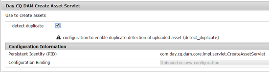

# 启用重复资产检测 {#enable-detection-of-duplicate-assets}

如果您尝试上传[!DNL Adobe Experience Manager Assets]中存在的资产，则重复检测功能会将该资产识别为重复资产。 默认情况下禁用重复检测。 要启用该功能，请执行以下步骤：

1. 通过访问`https://[aem_server]:[port]/system/console/configMgr`打开[!DNL Experience Manager] Web控制台配置页。
1. 编辑Servlet **[!UICONTROL Day CQ DAM创建资产]**&#x200B;的配置。
1. 选择&#x200B;**[!UICONTROL 检测重复项]**&#x200B;选项，然后单击&#x200B;**[!UICONTROL 保存]**。

   

   *图：在servlet中选择检测重复项选项。*

[!DNL Assets]中现在启用了检测重复项功能。 当用户尝试上传[!DNL Experience Manager]中存在的资源时，系统会检查冲突并指示冲突。 资产使用存储在`jcr:content/metadata/dam:sha1`上的SHA-1哈希进行标识，这意味着不论文件名如何，都会检测到重复的资产。

>[!MORELIKETHIS]
>
>* [复制现有存储库中的资产（社区成员的教程）](https://experience-aem.blogspot.com/2019/06/aem-65-find-duplicate-assets-binaries-in-existing-repository.html)
>* [在AEM as a Cloud Service中检测重复资源](https://experienceleague.adobe.com/docs/experience-manager-cloud-service/content/assets/admin/detect-duplicate-assets.html)
