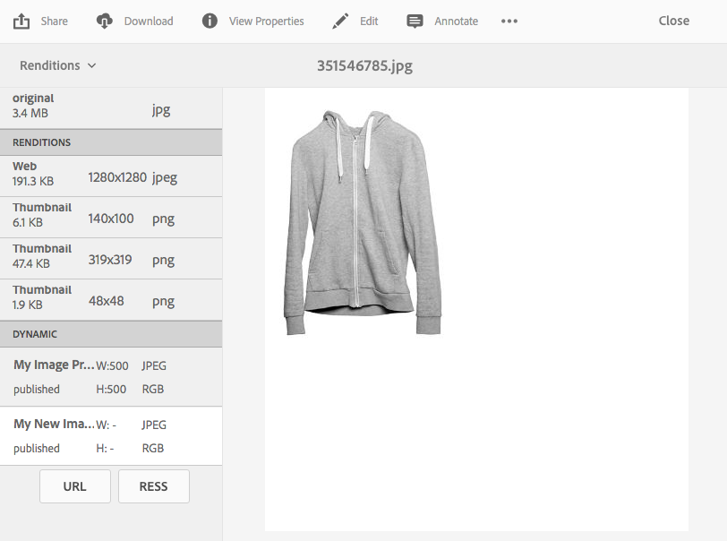

# 应用Dynamic Media图像预设 {#applying-image-presets}

利用图像预设，资产可以动态交付不同大小、不同格式的图像，或者使用动态生成的其他图像属性交付图像。 可以在导出图像时选择预设。 预设按照管理员指定的规范重新格式化图像。

此外，您还可以选择响应式图像预设（在选择后由&#x200B;**[!UICONTROL RESS]**&#x200B;按钮指定）。

本节介绍如何使用图像预设。 [管理员可以创建和配置图像预设](managing-image-presets.md)。

>[!NOTE]
>
>智能成像可与您现有的图像预设配合使用，并在交付的最后毫秒内使用智能功能，以根据浏览器或网络连接速度进一步减小图像文件大小。 有关详细信息，请参阅[智能成像](imaging-faq.md)。

无论您何时预览图像，都可以将图像预设应用于图像。

>[!NOTE]
>
>在Dynamic Media - Scene7模式下，仅图像资产支持图像预设。

**要应用Dynamic Media图像预设：**

1. 打开资产，在左边栏中，选择下拉菜单，然后选择&#x200B;**[!UICONTROL 呈现版本]**。

   >[!NOTE]
   >
   >* 静态演绎版显示在窗格的上半部分。 动态呈现版本将显示在下半部分。 仅通过动态演绎版，您可以使用URL显示图像。 仅当您选择动态呈现版本时，才会显示&#x200B;**[!UICONTROL URL]**&#x200B;按钮。 仅当您选择响应式图像预设时，才会显示&#x200B;**[!UICONTROL RESS]**&#x200B;按钮。
   >
   >* 当您在资产的“详细信息”视图中选择&#x200B;**[!UICONTROL 演绎版]**&#x200B;时，系统会显示大量演绎版。 您可以增加可查看的预设数。 请参阅[增加显示的图像预设数](managing-image-presets.md#increasing-or-decreasing-the-number-of-image-presets-that-display)。

   

1. 执行以下任一操作：

   * 选择动态演绎版，以便预览图像预设。
   * 要显示弹出窗口，请选择&#x200B;**[!UICONTROL URL]**、**[!UICONTROL 嵌入]**&#x200B;或&#x200B;**[!UICONTROL RESS]**。

   >[!NOTE]
   >
   >如果资产&#x200B;*和*&#x200B;图像预设尚未发布，**[!UICONTROL URL]**&#x200B;按钮(或&#x200B;**[!UICONTROL URL]**&#x200B;和&#x200B;**[!UICONTROL RESS]**&#x200B;按钮（如果适用）将不可用。
   >
   >另请注意，图像预设会自动发布在Dynamic Media服务器上。
