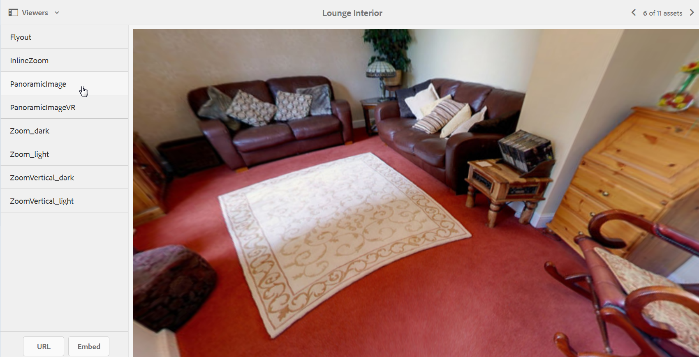

# 全景图像{#panoramic-images}

本节介绍如何使用全景图像查看器渲染球形全景图像，以获得房间、属性、位置或景观的360度沉浸式观看体验。

另请参阅[管理查看器预设](/help/assets/managing-viewer-presets.md)。

## 上传用于全景图像查看器的资产 {#uploading-assets-for-use-with-the-panoramic-image-viewer}

要使上传的资产符合要与全景图像查看器一起使用的球面全景图像的条件，该资产必须具有以下一项或两项之一：

* 长宽比为2。
您可以在以下位置覆盖CRXDE Lite中的默认纵横比设置2：
  `/conf/global/settings/cloudconfigs/dmscene7/jcr:content`

* 已用关键字`equirectangular`、`spherical`和`panorama`或`spherical`和`panoramic`标记。 请参阅[使用标记](/help/sites-authoring/tags.md)。

纵横比和关键字条件都适用于资产详细信息页面和`Panoramic Media` WCM组件的全景资产。

要上传用于全景图像查看器的资源，请参阅[上传Assets](/help/assets/manage-assets.md#uploading-assets)。

## 配置Dynamic Media Classic {#configuring-dynamic-media-classic-scene}

要使全景图像查看器在Adobe Experience Manager中正常工作，请将全景图像查看器预设与Dynamic Media Classic和特定于Dynamic Media Classic的元数据同步，以便在JCR中更新查看器预设。 要完成此同步，请按照以下方式配置Dynamic Media Classic：

1. 打开[Dynamic Media Classic桌面应用程序](https://experienceleague.adobe.com/docs/dynamic-media-classic/using/getting-started/signing-out.html#getting-started)，然后登录到您的帐户。

1. 在页面的右上角附近，选择&#x200B;**[!UICONTROL 设置]** > **[!UICONTROL 应用程序设置]** > **[!UICONTROL 发布设置]** > **[!UICONTROL 图像服务器]**。
1. 在图像服务器发布页面上，从顶部附近的&#x200B;**[!UICONTROL 发布上下文]**&#x200B;下拉菜单中，选择&#x200B;**[!UICONTROL 图像服务]**。

1. 在同一图像服务器发布页面上，找到标题&#x200B;**[!UICONTROL 请求属性]**。
1. 在请求属性标题下，找到&#x200B;**[!UICONTROL 回复图像大小限制]**。 然后，在关联的“宽度”和“高度”字段中，增加全景图像的最大允许图像大小。

   Dynamic Media Classic具有25,000,000像素的限制。 对于宽高比为2:1的图像，允许的最大大小为7000 x 3500。 但是，对于典型的台式机屏幕，4096 x 2048像素就足够了。

   >[!NOTE]
   >
   >仅支持位于允许的最大图像大小范围内的图像。 对超出大小限制的图像的请求会导致403响应。

1. 在“请求属性”标题下，执行以下操作：

   * 将请求模糊处理模式设置为&#x200B;**[!UICONTROL 已禁用]**。
   * 将请求锁定模式设置为&#x200B;**[!UICONTROL 已禁用]**。

   在Experience Manager中使用`Panoramic Media` WCM组件时需要这些设置。

1. 在“图像服务器发布”页面的底部，选择左侧的&#x200B;**[!UICONTROL 保存]**。

1. 在右下角，选择&#x200B;**[!UICONTROL 关闭]**。

### 全景媒体WCM组件故障诊断 {#troubleshooting-the-panoramic-media-wcm-component}

如果将图像放入WCM中的全景媒体组件，并且组件占位符折叠，请解决以下问题：

* 如果您遇到403禁止错误，可能是由于请求的图像大小过大。 查看[配置Dynamic Media Classic](/help/assets/panoramic-images.md#configuring-dynamic-media-classic-scene)中的&#x200B;**[!UICONTROL 回复图像大小限制]**&#x200B;设置。

* 对于页面上显示的“资产锁定无效”或“解析错误”，请选中请求模糊处理模式和请求锁定模式以确保禁用它们。
* 对于污染的画布错误，请设置规则集定义文件路径并使图像资产的先前请求的CTN无效。
* 如果图像请求的大小超过支持的限制后图像质量变差，请检查&#x200B;**[!UICONTROL JPEG编码属性>质量]**&#x200B;设置是否不为空。 **[!UICONTROL 质量]**&#x200B;字段的典型设置是`95`。 您可以在图像服务器发布页面中找到设置。 要访问该页面，请参阅[配置Dynamic Media Classic](/help/assets/panoramic-images.md#configuring-dynamic-media-classic-scene)。

## 预览全景图像 {#previewing-panoramic-images}

请参阅[预览Assets](/help/assets/previewing-assets.md)。

## 发布全景图像 {#publishing-panoramic-images}

请参阅[发布Assets](/help/assets/publishing-dynamicmedia-assets.md)。
