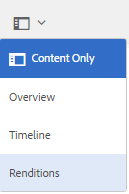
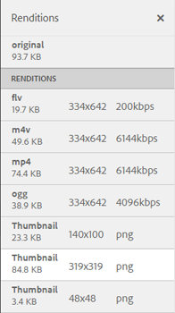

# 视频演绎版 {#video-renditions}

Adobe Experience Manager Assets为各种格式（包括OGG、FLV等）的视频资源生成视频演绎版。

Experience Manager Assets支持Media Assets的静态和动态呈现（DM编码的呈现）。

使用FFMPEG（安装在系统路径上并可用）原生生成静态演绎版，并将其存储在内容存储库中。

DM编码的演绎版存储在代理服务器中，并在运行时提供服务。

Experience Manager Assets在客户端为这些演绎版提供播放支持。

要查看特定视频资源的演绎版，请打开其资源页面，然后选择全局导航图标。 然后，从列表中选择&#x200B;**[!UICONTROL 呈现版本]**。

视频演绎版列表显示在&#x200B;**[!UICONTROL 演绎版]**&#x200B;面板中。

若要为DM编码的呈现配置代理服务器，[配置Dynamic Media云服务](config-dynamic.md)。

若要使用所需的参数生成视频演绎版，[请创建对应的视频配置文件](video-profiles.md)。

配置代理服务器并创建视频配置文件后，您可以在处理配置文件中包含此视频预设，并将处理配置文件应用到文件夹。

>[!NOTE]
>
>音频播放不适用于® Internet Explorer 11上的OGG和WAV文件。 对于扩展名为OGG或WAV的资源，资源详细信息页面上会显示错误`Invalid Source`。
>
>在MS® Edge和iPad上，OGG文件不会播放并引发不支持的格式错误。
