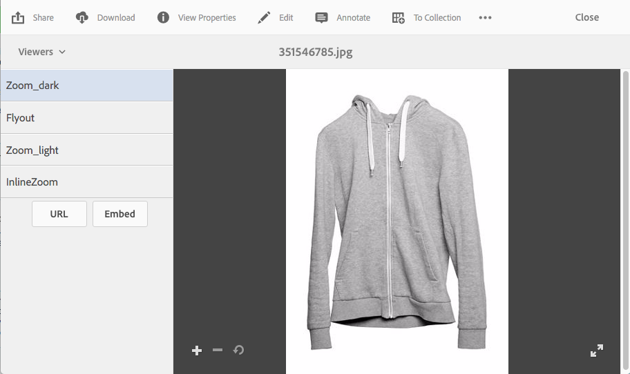

# 应用Dynamic Media查看器预设 {#applying-viewer-presets}

查看器预设是设置集合，用于确定用户在其计算机屏幕和移动设备上查看富媒体资产的方式。 您可以将管理员创建的任何查看器预设应用到资产。

如果您是管理员，并且必须管理、创建、排序和删除查看器预设，请参阅[管理查看器预设](managing-viewer-presets.md)。

另请参阅[发布查看器预设](managing-viewer-presets.md#publishing-viewer-presets)。

根据您使用的发布模式，您无需发布查看器预设。
有关查看器预设的任何问题，请参阅[Dynamic Media疑难解答 — Scene7](troubleshoot-dms7.md#viewers)。

## 将Dynamic Media查看器预设应用于资产 {#applying-a-viewer-preset-to-an-asset}

1. 打开资产并在左边栏中，选择&#x200B;**[!UICONTROL 查看器]**。

   

   * 选择查看器预设后，将显示 **[!UICONTROL URL]** 和&#x200B;**[!UICONTROL 嵌入]**&#x200B;按钮。
   * 当您在资产的&#x200B;**[!UICONTROL 详细信息视图]**&#x200B;中选择查看器时，系统会显示大量查看器预设。 您可以增加可查看的预设数。 请参阅[增加显示的查看器预设数](managing-viewer-presets.md)。

1. 从左窗格中选择一个查看器，以便将其应用到右窗格中显示的资源。 您还可以[复制URL以与其他用户共享](linking-urls-to-yourwebapplication.md)。

## 获取查看器预设URL {#obtaining-viewer-preset-urls}

若要获取查看器预设的URL，请参阅[将URL链接到您的Web应用程序](linking-urls-to-yourwebapplication.md)。
