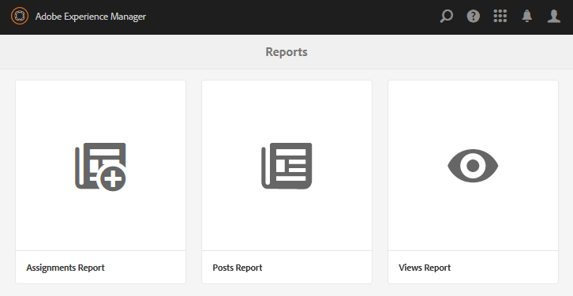
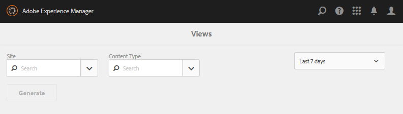
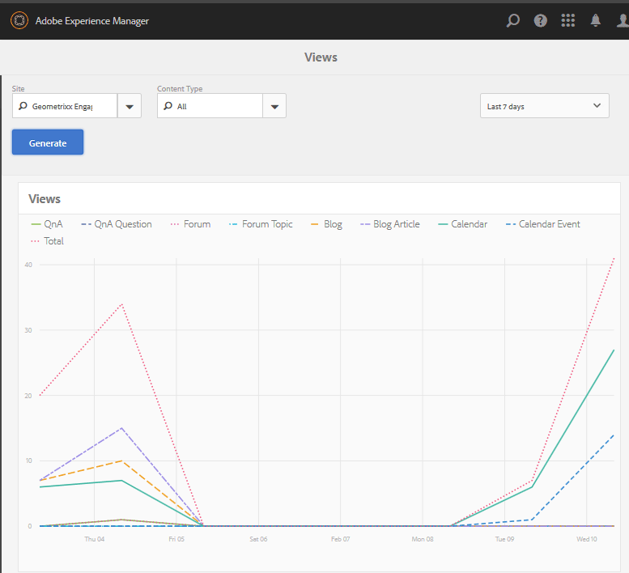
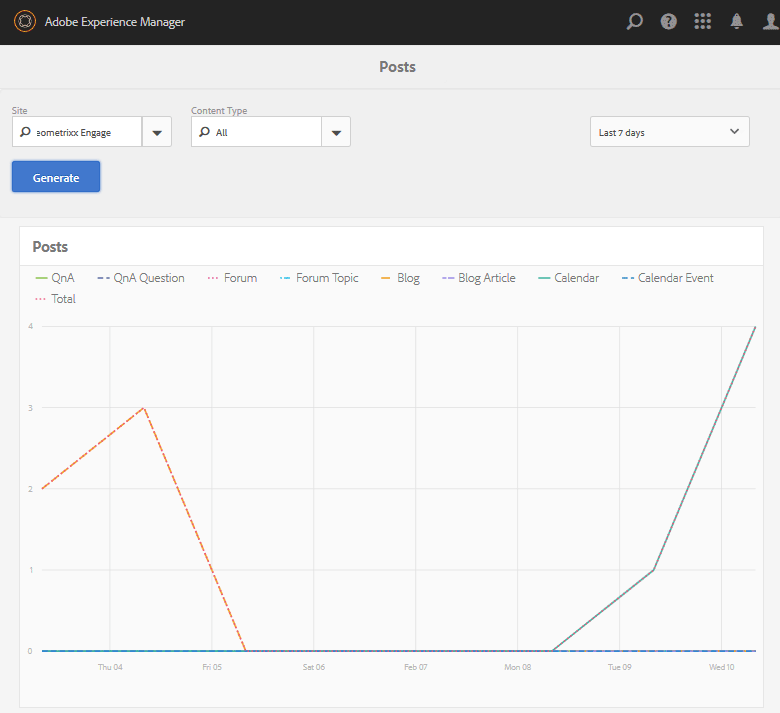
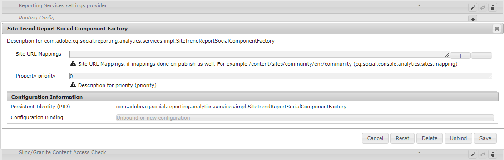

# 报表控制台 {#reports-console}

## 概述 {#overview}

对于AEM Communities，可以通过多种方式从创作环境访问各种报表。

一般来说，各种报告包括：

* [查看报告](#views-report)

  按社区成员和站点访客提供任意社区站点的内容视图图表。

* [发布报告](#posts-report)

  提供社区成员在任何社区站点上发表的各种类型的帖子的图表。

表格报表可以导出为.csv格式以供后续处理。

## 报表控制台 {#reporting-consoles}

### 社区站点报表 {#reports-for-community-sites}

* 从全局导航： **[!UICONTROL 导航]** > **[!UICONTROL 社区]** > **[!UICONTROL 报告]**

* 选择自：

  * **[!UICONTROL 工作分配报表]**

    * 为选定的社区站点、用户或组以及分配生成报告。

  * **[!UICONTROL 发布报告]**

    * 为选定的社区站点、内容类型和时间段生成报告。

  * **[!UICONTROL 查看报告]**

    * 为选定的社区站点、内容类型和时间段生成报告。

## 查看次数报表 {#views-report}

通过视图控制台，可按社区功能生成给定时间段内的页面查看报告。

选择报告的标准：

* **[!UICONTROL 站点]**

  选择社区站点。

* **[!UICONTROL 内容类型]**

  可以选择“所有内容”或选择网站上存在的功能之一。

* **[!UICONTROL 期限]**

  选择以下选项之一：

  * 过去 7 天
  * 过去 30 天
  * 过去 90 天
  * 去年

选择&#x200B;**[!UICONTROL 生成]**&#x200B;以创建报告。

## 发布报表 {#posts-report}

“帖子”控制台允许生成给定时间段内社区功能的帖子数量报告。

选择报告的标准：

* **[!UICONTROL 站点]**

  选择社区站点。

* **[!UICONTROL 内容类型]**

  可以选择“所有内容”或选择网站上存在的功能之一。

* **[!UICONTROL 期限]**

  选择以下选项之一：

  * 过去 7 天
  * 过去 30 天
  * 过去 90 天
  * 去年

选择&#x200B;**[!UICONTROL 生成]**&#x200B;以创建报告。

## 疑难解答 {#troubleshooting}

### 未列出社区站点 {#no-community-sites-listed}

如果未列出任何社区站点，请确保已为站点启用Adobe Analytics。 如果选择工作分配报表，请确保工作分配功能在社区站点的结构中。

### 报告未显示在AEM创作实例中 {#reports-do-not-show-in-aem-author-instance}

如果报表未显示在AEM创作实例中，请检查是否存在自定义设置，例如发布实例上的URL映射。 如果仅在Communities站点的AEM发布实例上完成URL映射，请确保在&#x200B;**站点趋势报表社交组件工厂**&#x200B;配置中的AEM创作实例中已配置相同内容。

AEM作者上的
