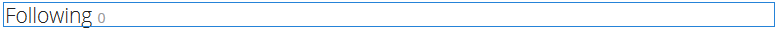

# 使用社交图 {#using-social-graph}

## 简介 {#introduction}

社区成员关注[活动](activities.md)且被关注的能力是通过两个组件建立的： `Follow`和`Following`。

`Follow`组件必须与其他资源关联，并且已为社区成员和功能建立此关联。

`Following`组件仅列出位于当前成员后面或位于当前成员后面的成员。 此成员间关系的社交图包含在为[社区站点](overview.md#communitiessites)建立的用户个人资料中。

## 向页面添加以下内容 {#adding-following-to-a-page}

如果想要将`Following`组件添加到创作模式下的页面，请找到组件`Communities / Following`，并将其拖动到应显示社交图的页面上的适当位置。

有关必要的信息，请访问[社区组件基础知识](basics.md)。

当包含[所需的客户端库](essentials-socialgraph.md#essentials-for-client-side)时，`Following`组件的显示方式如下：

## 配置以下 {#configuring-following}

当前，需要设置属性以确定组件显示`follows`关系还是`following`关系。

## 附加信息 {#additional-information}

更多信息可在[Social Graph Essentials](essentials-socialgraph.md)页面上找到开发人员。
