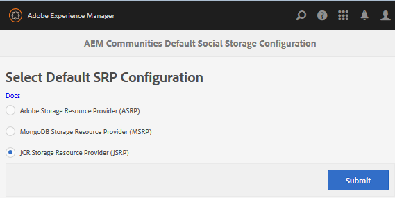

# 存储配置 {#storage-configuration}

存储配置是标识为社区内容(也称为用户生成内容(UGC))选择的存储的方法。

此设置会通知AEM Communities代码，在访问UGC时使用了存储资源提供程序(SRP)的实现。 它必须反映部署Adobe Experience Manager (AEM)时建立的拓扑。

有关存储选项和部署拓扑的讨论，请访问：

* [社区内容存储](working-with-srp.md)
* [推荐的拓扑](topologies.md)

## 存储配置控制台 {#storage-configuration-console}

在创作环境中，访问存储配置控制台。

* 从全局导航中，选择&#x200B;**[!UICONTROL 工具]** > **[!UICONTROL 社区]** > **[!UICONTROL 存储配置]**

要选择默认JCR以外的存储选项，请执行以下操作：

* 选择一个选项
* 正确配置

  * 查看[选择MSRP](msrp.md#select-msrp)的详细信息
  * 查看[选择DSRP](dsrp.md#select-dsrp)的详细信息
  * 查看[选择ASRP](asrp.md#select-asrp)的详细信息

* 选择&#x200B;**[!UICONTROL 提交]**。

### 关于JCR存储 {#about-jcr-storage}

如果未进行任何选择，则默认为AEM存储库JCR。

JCR是&#x200B;*而非*&#x200B;创作和发布环境共享的公用存储。 社区内容仅在创建该内容的创作或发布环境中可见。

访问[JCR存储](jsrp.md)以获取更多信息。

>[!NOTE]
>
>`/etc/socialconfig`下的节点`srpc`缺失表示默认[JCR存储](jsrp.md)。
