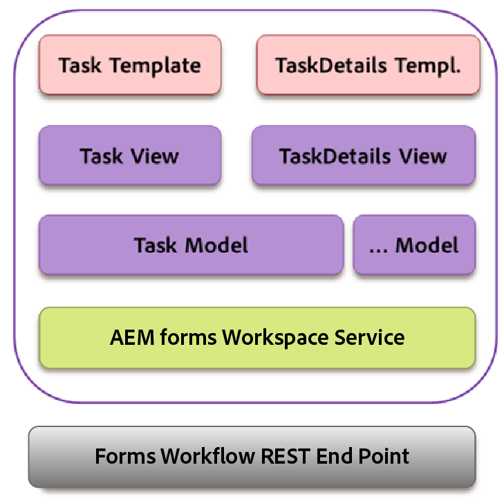

# Backbone 交互{#backbone-interaction}

Backbone是一个库，它有助于在Web应用程序中创建和遵循MVC架构。 Backbone的基本思想是将界面组织为逻辑视图，以模型为后盾，每个模型都可以在模型更改时独立更新，而无需重新绘制页面。 有关主干的更多信息，请参阅[https://backbonejs.org](https://backbonejs.org/)。

一些关键概念如下所示：

**骨干模型**&#x200B;包含数据，以及与此数据相关的大部分逻辑。

**主干视图**&#x200B;用于表示相应模型的状态。 骨干视图的行为实际上类似于控制器，侦听用户界面事件（如用户点击）或为事件建模（如数据已更改），并根据需要修改用户界面。

**HTML模板**&#x200B;包含由模型填充的占位符的包装器模板。

**AEM Forms工作区**&#x200B;包含多个单独的组件。 每个组件：

* 表示单个逻辑用户界面元素。
* 可以是类似组件的集合。
* 由骨干模型、骨干视图和HTML模板组成。
* 包含对服务的引用。
* 包含对所需实用程序的引用。

初始化组件时，将创建以下对象：

* 为组件创建了主干模型的新实例。 服务被插入到模型中。
* 将创建一个主干视图的新实例。
* 相应模型、HTML模板和实用程序的实例将插入视图中。

在骨干视图中，有一个事件映射，用于映射由于用户界面与相应处理程序的交互而可能产生的各种事件。 初始化组件后，将启动此映射。

初始化视图后，该视图会调用其相应的模型以从服务器获取数据。 视图所需的所有数据都可用后，视图将按照HTML模板指定的格式呈现数据。 多个视图可以共享相同的通信模型。

示例：

1. 用户单击任务列表中的任务模板。
1. 任务视图侦听单击，并调用任务模型上的渲染函数。
1. 任务模型随后调用该服务，该服务是与AEM Forms服务器进行所有通信的共同点。
1. 服务类通过ajax为渲染方法调用AEM Forms REST端点。
1. 此Ajax调用的成功回调在任务模型中定义。
1. 任务模型引发骨干事件作为渲染调用完成的通知。
1. 另一个视图，任务详细信息视图从任务模型侦听此事件。
1. 任务详细信息视图然后更改任务详细信息模板，以便向用户显示呈现的任务（表单、详细信息、附件、注释等）。
