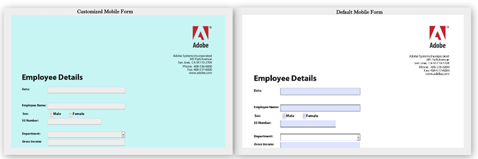

# 更改 HTML5 Forms 的默认样式{#changing-default-styles-of-html-forms}

HTML5表单使用HTML5功能渲染，渲染表单的样式使用CSS完成。 HTML5表单的默认外观与其PDF演绎版类似。 开发人员可以使用自定义CSS更改HTML5表单的默认外观。

本文提供了更改HTML5表单样式的分步信息，并且[样式简介](/help/forms/using/css-styles.md)文章包含有关HTML5表单各种样式方面的详细信息。 在执行本文中提到的步骤之前，请确保已阅读样式简介一文。

以下两幅图像显示了默认样式和自定义样式之间的差异。

## 设置表单样式 {#style-your-forms}

1. **选择配置文件以添加自定义样式**

   访问CRX DE接口，网址为： **https://&lt;server>：&lt;port>/crx/de**，然后创建配置文件或选择现有配置文件。 要了解如何创建配置文件，请参阅[创建配置文件](/help/forms/using/custom-profile.md)

1. **创建用于设置HTML5表单样式的CSS样式表**

   导航到已在其中创建配置文件渲染器的文件夹，然后创建CSS样式表文件。 要遵循的步骤为

   1. 右键单击文件夹，然后从菜单中选择&#x200B;**创建** > **创建文件**

   1. 在“创建文件”对话框中，输入样式表的名称。 确保使用.css扩展名（例如，stylesheet.css）
   1. 从导航窗格中，打开已创建的CSS文件。
   1. 定义要设置样式的组件的CSS类，并在这些类中添加样式。

   若要了解在HTML5表单中为特定组件创建哪些CSS类，请参阅[样式简介](/help/forms/using/css-styles.md)。

1. **在配置文件渲染器中包含样式表**

   在CRX DE中打开“配置文件渲染器”页面（jsp文件），并将CSS文件包含在XFA客户端库正下方的页面中。 执行这些步骤可在配置文件中包含CSS文件。

   1. 在渲染器中搜索以下行：

      &lt;cq:includeClientLib类别=&quot;xfaforms.profile&quot; />

   1. 在上面的行下面插入以下内容以包含样式表：

      &lt;link href=&quot;/path/to/stylesheet&quot; rel=&quot;stylesheet&quot; type=&quot;text/css&quot;/>

   1. 保存文件。
