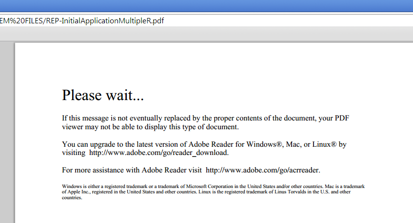
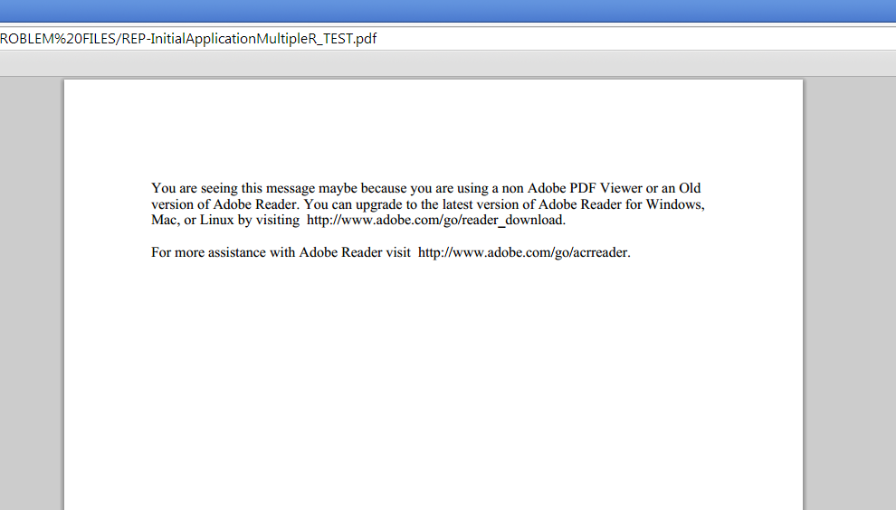

# 在 Designer 中更改 Page Zero 内容 {#changing-page-zero-content-in-designer}

如果非Adobe PDF查看器（如[!DNL Chrome]或[!DNL Firefox]中的默认PDF查看器）无法读取PDF/XFA表单的内容，则默认显示零页内容。 默认的Page Zero消息如下所示。

[!DNL AEM Forms]版本的Designer允许您更改在第0页上显示的消息。 要更改Page Zero消息，请执行以下步骤：

1. 确保您已安装[!DNL AEM Forms]版本的Designer。 您可以从设计器的“关于”屏幕中检查版本。

1. 打开要为其更改“页面零”内容的表单。

1. 单击&#x200B;**[!UICONTROL 文件]** > **[!UICONTROL 表单属性]**。

1. 在[!UICONTROL 表单属性]对话框中，单击（加号图标）以添加自定义属性。

1. 将&#x200B;**_pagezerocontent**&#x200B;指定为属性的名称。
1. 以富文本格式添加新的“页面零”消息作为值。 例如：

   `<body xmlns="http://www.w3.org/1999/xhtml" xmlns:xfa="http://www.xfa.org/schema/xfa-data/1.0/">
 

You are seeing this message maybe because you are using a non Adobe PDF Viewer or an Old version of Adobe Reader. You can upgrade to the latest version of Adobe Reader for Windows, Mac, or Linux by visiting  https://www.adobe.com/go/reader_download_cn.

 

For more assistance with Adobe Reader visit  https://www.adobe.com/go/acrreader_cn.
</body>`

1. 将表单另存为PDF。

1. 在浏览器中查看PDF表单，确认消息已更新。 上面的示例值如下所示：

   

>[!NOTE]
>
>重新打开表单时，您创建的自定义属性可能无法正确显示在表单属性对话框中。 但是，它可正常使用，并且表单会显示更新的零页消息。
