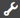
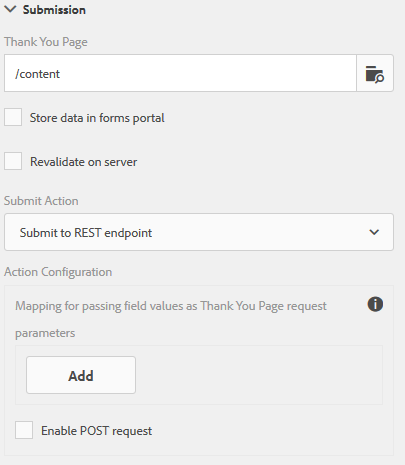

# 配置重定向页面{#configuring-redirect-page}

Adobe 建议使用现代、可扩展的数据捕获[核心组件](https://experienceleague.adobe.com/docs/experience-manager-core-components/using/adaptive-forms/introduction.html)，以[创建新的自适应表单](/help/forms/using/create-an-adaptive-form-core-components.md)或[将自适应表单添加到 AEM Sites 页面](/help/forms/using/create-or-add-an-adaptive-form-to-aem-sites-page.md)。 这些组件代表了自适应表单创建方面的一大进步，可确保提供令人印象深刻的用户体验。 本文介绍了使用基础组件创作自适应表单的旧方法。

| 版本 | 文章链接 |
| -------- | ---------------------------- |
| AEM as a Cloud Service | [单击此处](https://experienceleague.adobe.com/docs/experience-manager-cloud-service/content/forms/adaptive-forms-authoring/authoring-adaptive-forms-foundation-components/configure-submit-actions-and-metadata-submission/configuring-redirect-page.html) |
| AEM 6.5 | 本文 |

表单作者可为每个表单配置一个页面，表单用户在提交表单后会重定向到该页面。

1. 在编辑模式下，选择一个组件，然后单击 > **自适应表单容器**，然后单击。

1. 在侧栏中，单击&#x200B;**提交**。

1. 在提交部分的感谢页面下提供重定向页面的URL。
1. 或者，在提交操作下，对于提交到REST端点操作，您可以配置要传递到重定向页面的参数。

重定向页面配置

表单作者可以使用传递到“感谢”页面的以下参数。 对于所有可用的提交操作，传递`status`和`owner`参数。 除了这两个参数之外，还会为以下提交操作传递一些其他参数：

* **存储内容操作**（已弃用）：传递`contentPath`，它是存储提交数据的存储库中节点的路径。

* **存储PDF操作**（已弃用） ：已传递`contentPath`（已提交的数据以及存储PDF文件到存储库中的节点的路径）。

* **提交到Forms工作流**：传递从表单工作流返回的输出参数。

* **提交到REST终结点**：传递为字段内到参数映射添加的参数。 未在此提交操作中传递`status`和`owner`参数。 有关详细信息，请参阅[配置提交到REST终结点提交操作](../../forms/using/configuring-submit-actions.md)。
