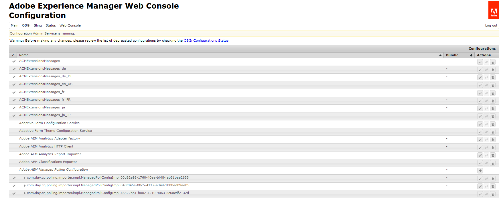
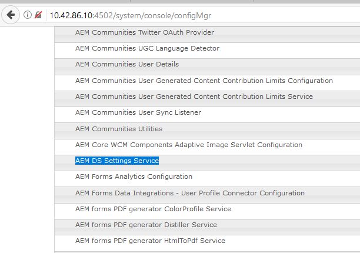
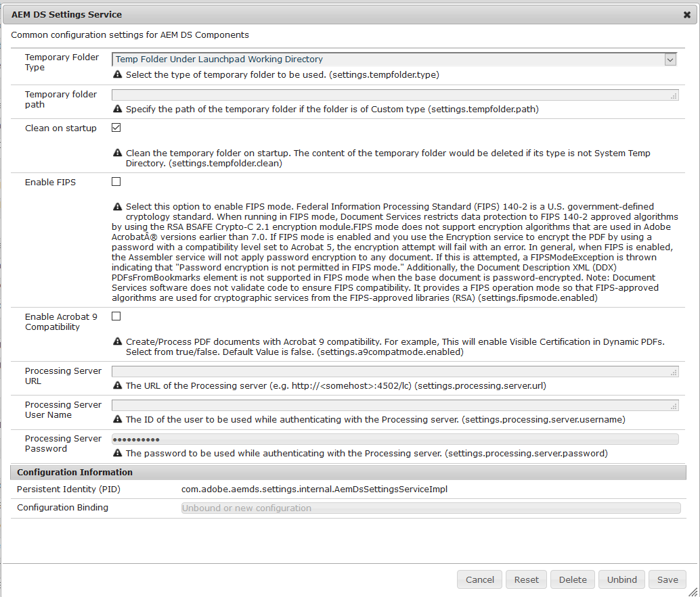

# 配置 AEM DS 设置{#configuring-aem-ds-settings}

本文介绍了如何配置&#x200B;**AEM DS设置服务**。 此设置可用于多种场景，例如：

* 在通信管理中

  * 用于配置AEM Forms工作流程
  * 使用Forms门户远程保存草稿/提交内容时

* 在自适应表单中，适用于从发布实例提交自适应表单的情况

以下是配置&#x200B;**[!UICONTROL AEM DS设置]**&#x200B;的步骤：

1. 使用URL在发布实例上打开配置管理器：\
   *https://localhost:port/system/console/configMgr*。

   

1. 在&#x200B;**[!UICONTROL Adobe Experience Manager Web控制台配置]**&#x200B;窗口中，找到并单击&#x200B;**[!UICONTROL AEM DS设置]**&#x200B;选项。

   

1. **[!UICONTROL AEM DS设置服务]**&#x200B;窗口显示AEM DS组件的通用配置设置。

   

1. 在相应字段中添加以下信息：

   **[!UICONTROL 处理服务器URL]**：处理服务器是必须触发Forms或AEM工作流的服务器。 这可以与AEM创作实例的URL或其他服务器URL（即https://localhost:port/）相同。

   **[!UICONTROL 正在处理服务器用户名]**：工作流用户的用户名[基于正在使用的服务器URL]

   **[!UICONTROL 正在处理服务器密码]**：工作流用户的密码

   >[!NOTE]
   >
   >
   >    
   >    
   >    * 使用Forms或AEM工作流时，在从发布服务器进行任何提交之前，必须配置DS设置服务。 否则，表格提交将失败。
   >    
   >
