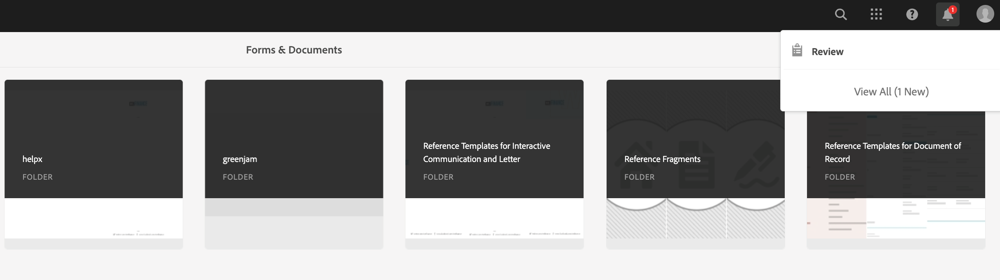
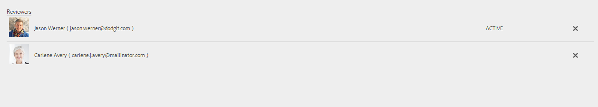
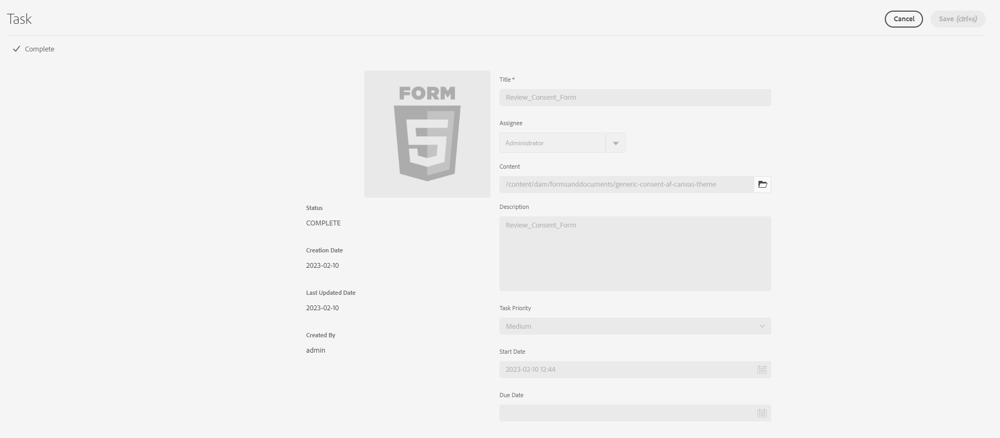

# 创建和管理表单审核{#creating-and-managing-reviews-to-forms}

Adobe 建议使用现代、可扩展的数据捕获[核心组件](https://experienceleague.adobe.com/docs/experience-manager-core-components/using/adaptive-forms/introduction.html?lang=zh-Hans)，以[创建新的自适应表单](/help/forms/using/create-an-adaptive-form-core-components.md)或[将自适应表单添加到 AEM Sites 页面](/help/forms/using/create-or-add-an-adaptive-form-to-aem-sites-page.md)。 这些组件代表了自适应表单创建方面的一大进步，可确保提供令人印象深刻的用户体验。 本文介绍了使用基础组件创作自适应表单的旧方法。

| 版本 | 文章链接 |
| -------- | ---------------------------- |
| AEM as a Cloud Service | [单击此处](https://experienceleague.adobe.com/docs/experience-manager-cloud-service/content/forms/adaptive-forms-authoring/authoring-adaptive-forms-foundation-components/create-reviews-forms.html?lang=zh-Hans) |
| AEM 6.5 | 本文 |

## 审阅 {#review}

审阅是一种允许一个或多个审阅人对表单进行评论的机制。

## 设置审阅 {#setting-up-a-review}

1. 导航到表单浏览器，然后选择要审阅的表单。
1. 如果表单没有正在进行的审阅，则操作栏中会显示一个&#x200B;**开始审阅** 图标。 单击&#x200B;**开始审阅**图标。
1. 输入以下信息：

   * **标题**：必填，可包含字母数字字符、连字符和下划线。
   * **描述**：目的/内容描述可选，可供审阅。
   * **截止日期**：可选，为审核结束的日期。 超过截止日期时，该任务显示为“过期”。
   * **审阅者姓名**：至少必须有一个。 使用组合框添加审阅人，键入包含所有匹配名称的名称列表；选择名称并单击&#x200B;**添加**。 在&#x200B;**审阅人**&#x200B;选项卡的下一部分显示所有审阅人的名称。

1. 单击&#x200B;**开始**&#x200B;开始审核。

   >[!NOTE]
   >
   >* 管理员可以访问与表单用户关联的任何组。
   >* 服务用户组不可选择进行审阅。

### 设置审核时发生的操作 {#actions-that-occur-when-a-review-is-set-up}

本节介绍创建或设置审阅时会发生什么情况。

1. 将创建一个新的审阅任务并将其分配给选定的审阅者。
1. 将为所有审阅人分配审阅任务。 任务将显示在其“通知”部分中。 查看者可以单击通知，或转到“收件箱”查看任务。 审核者可以单击打开审核任务，查看表单，并开始添加注释。

   

   查看者通知警报

1. 该注释框可供表单审阅者使用。 其他人可以阅读这些评论，但不能添加自己的评论。

## 管理审阅 {#managing-a-review}

>[!NOTE]
>
>* 只能修改正在进行的审阅。
>* 无法修改已完成的审核。

1. 导航到表单选项卡并选择表单。

1. 如果表单正在进行审阅，并且您是审阅的发起人，则操作栏中会显示&#x200B;**管理审阅** 图标。 只有审阅发起人才能管理（更新/结束）审阅。

   单击&#x200B;**管理审阅**图标。

   对于启动器以外的用户，“管理审阅”图标处于禁用状态。

1. 现在，您会看到一个显示信息的屏幕：

   * **审阅名称**：无法编辑。

   * **查看描述**：可供编辑。

   * **审核截止日期**：可供编辑。 可以将截止日期修改为当前日期和时间之后的任何日期和时间。

   * **审阅人**：可供编辑。 您可以添加或删除审阅人。 如果任务过期，则只有在将截止日期延长至当前日期之后才能添加审阅人。

1. 要结束审阅，请单击&#x200B;**结束**。

### 修改审核时发生的操作 {#actions-that-occur-when-a-review-is-modified}

本节介绍&#x200B;**审核更新/结束**&#x200B;时发生的操作：

1. 如果修改了审阅说明，则审阅者和发起者的相应任务将更新。
1. 如果修改了审阅截止日期，审阅人的相应任务将使用新日期更新。

1. 如果移除审阅者：

   

   删除审阅人

   1. 如果不完整，则终止分配的任务。
   1. 审核者无法再对表单进行评论。

1. 如果添加审阅人：

   

   添加审阅者

   1. 审阅任务已创建并分配给新添加的审阅人。
   1. 新添加的审核者可以添加有关表单的注释。

1. 当审核结束时：

   1. **审阅人**：对于每个审阅人，与审阅相关的未完成任务将终止。 任务在查看者的Notifications部分中不再显示为&#39;Pending&#39;。
   1. **启动器**：分配给审阅启动器的任务已标记为完成。 任务将从审阅发起人的Notification部分删除。
   1. **全部**：审核显示在“以前的审核”部分中。 无法添加其他注释。

   
