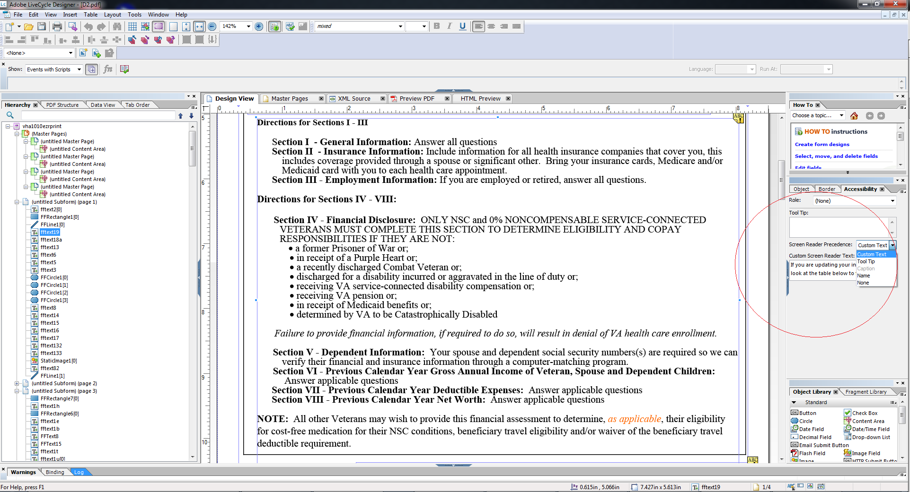

# 无障碍 HTML5 Forms 设计 {#designing-accessible-html-forms}

HTML5表单使用ARIA HTML5辅助功能标准生成无障碍的HTML表单。 这些表单支持选项卡式导航（Mozilla FireFox除外），经认证与常用屏幕阅读器兼容。 要生成具有良好辅助功能的HTML5表单，请根据一些基本设计准则来设计XFA表单模板。 设计准则包括配置正确的制表符顺序并为每个表单控件提供“说文本”内容。 AEM Forms Designer支持设置这些表单控件属性，以生成可访问的PDF和HTML5表单。

*注释:Tabbed导航未涵盖受保护字段，例如显示值总和的计算字段。 要使屏幕阅读器读取受保护字段的值，请在受保护字段的顶部或旁边放置一个空的只读字段。 将受保护字段的值分配给新的只读字段。 屏幕阅读器或选项卡式导航器可以选取此只读字段，并将其作为受保护字段的值发出。*

AEM Forms Designer包含多个可传递给屏幕阅读器的说文本选项。 对于表单中的每个对象，用户可以为屏幕阅读器文本指定以下几种设置之一：

* 自定义屏幕阅读器文本，可以使用“辅助功能”面板进行设置。 作者可以注释按钮和字段的名称及其用途。
* 工具提示，可在“辅助功能”面板中设置这些提示。
* 表单中的字段标题。
* 对象名称，在“绑定”选项卡的“名称”选项中指定。

当表单控件上有工具提示、屏幕Reader文本和标题等多个选项可用时，屏幕Reader仅使用这些属性之一。 默认顺序为“自定义屏幕Reader文本”、“工具提示”、“标题”和“名称”。 您可以使用辅助功能面板中的屏幕Reader **优先顺序**&#x200B;选项覆盖默认顺序。
