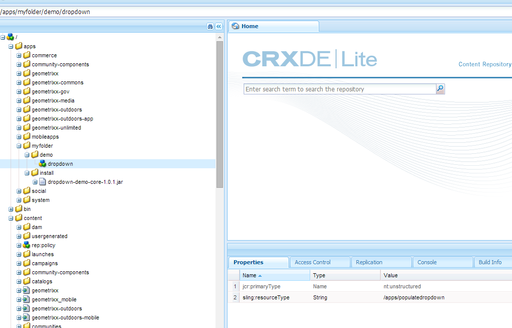
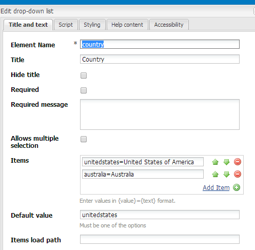
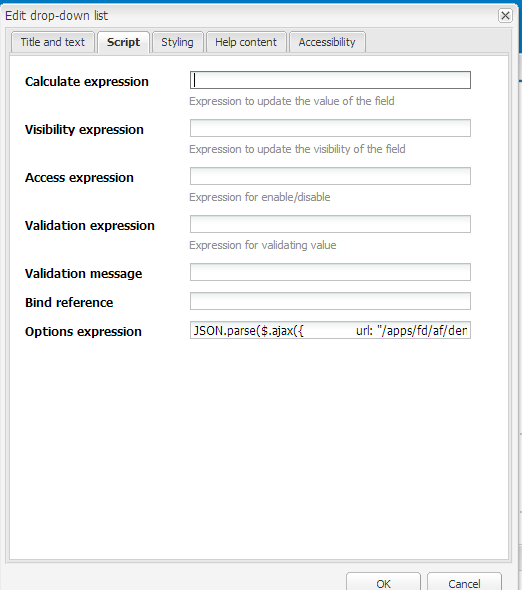
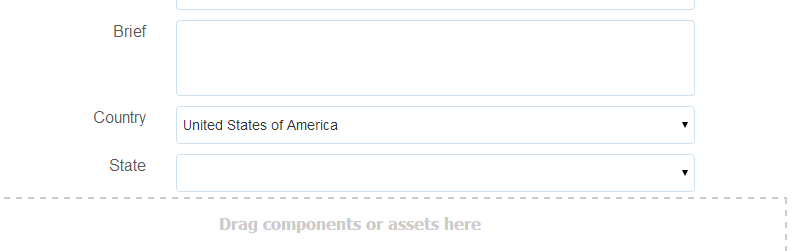

# 动态填充下拉列表 {#dynamically-populating-drop-down-lists}

## 先决条件 {#prerequisites}

* [创建OSGi包](https://helpx.adobe.com/experience-manager/using/creating-osgi-bundles-digital-marketing.html)
* [开发AEM组件](/help/sites-developing/components.md)
* [创建自适应表单](../../forms/using/creating-adaptive-form.md)
* [创作自适应表单](../../forms/using/introduction-forms-authoring.md)

## 动态填充下拉列表的过程 {#procedure-to-dynamically-populate-drop-down-lists}

假设您想根据在&#x200B;**国家/地区**&#x200B;下拉列表中选择的值填充&#x200B;**国家/地区**&#x200B;下拉列表。 如果在&#x200B;**国家/地区**&#x200B;下拉列表中选择澳大利亚，则&#x200B;**国家/地区**&#x200B;下拉列表将显示澳大利亚境内的国家/地区。 以下过程介绍了如何完成此任务。

1. 创建包含以下模块的项目：

   * 包含用于填充下拉列表的逻辑的捆绑包，在本例中为servlet。
   * 内容，嵌入了.jar文件并具有下拉资源。 servlet指向此资源。

1. 编写基于请求参数Country的servlet，该参数返回一个包含国家/地区内州名的数组。

   ```java
   @Component(metatype = false)
   @Service(value = Servlet.class)
   @Properties({
           @Property(name = "sling.servlet.resourceTypes", value = "/apps/populatedropdown"),
           @Property(name = "sling.servlet.methods", value = {"GET", "POST"}),
           @Property(name = "service.description", value = "Populate states dropdown based on country value")
   })
   public class DropDownPopulator extends SlingAllMethodsServlet {
       private Logger logger = LoggerFactory.getLogger(DropDownPopulator.class);
   
       protected void doPost(SlingHttpServletRequest request,
                             final SlingHttpServletResponse response)
               throws ServletException, IOException {
           response.setHeader("Access-Control-Allow-Origin", "*");
           response.setContentType("application/json");
           response.setCharacterEncoding("UTF-8");
           try {
               String US_STATES[] = {"0=Alabama",
                       "1=Alaska",
                       "2=Arizona",
                       "3=Arkansas",
                       "4=California",
                       "5=Colorado",
                       "6=Connecticut",
                       "7=Delaware",
                       "8=Florida",
                       "9=Georgia",
                       "10=Hawaii",
                       "11=Idaho",
                       "12=Illinois",
                       "13=Indiana",
                       "14=Iowa",
                       "15=Kansas",
                       "16=Kentucky",
                       "17=Louisiana",
                       "18=Maine",
                       "19=Maryland",
                       "20=Massachusetts",
                       "21=Michigan",
                       "22=Minnesota",
                       "23=Mississippi",
                       "24=Missouri",
                       "25=Montana",
                       "26=Nebraska",
                       "27=Nevada",
                       "28=New Hampshire",
                       "29=New Jersey",
                       "30=New Mexico",
                       "31=New York",
                       "32=North Carolina",
                       "33=North Dakota",
                       "34=Ohio",
                       "35=Oklahoma",
                       "36=Oregon",
                       "37=Pennsylvania",
                       "38=Rhode Island",
                       "39=South Carolina",
                       "40=South Dakota",
                       "41=Tennessee",
                       "42=Texas",
                       "43=Utah",
                       "44=Vermont",
                       "45=Virginia",
                       "46=Washington",
                       "47=West Virginia",
                       "48=Wisconsin",
                       "49=Wyoming"};
               String AUSTRALIAN_STATES[] = {"0=Ashmore and Cartier Islands",
                       "1=Australian Antarctic Territory",
                       "2=Australian Capital Territory",
                       "3=Christmas Island",
                       "4=Cocos (Keeling) Islands",
                       "5=Coral Sea Islands",
                       "6=Heard Island and McDonald Islands",
                       "7=Jervis Bay Territory",
                       "8=New South Wales",
                       "9=Norfolk Island",
                       "10=Northern Territory",
                       "11=Queensland",
                       "12=South Australia",
                       "13=Tasmania",
                       "14=Victoria",
                       "15=Western Australia"};
               String country = request.getParameter("country");
               JSONArray stateJsonArray = new JSONArray();
               if (country.length() > 0) {
                   if ("australia".equalsIgnoreCase(country)) {
                       stateJsonArray = new JSONArray();
                       for (String state : AUSTRALIAN_STATES) {
                           stateJsonArray.put(state);
                       }
                   } else if ("unitedstates".equalsIgnoreCase(country)) {
                       stateJsonArray = new JSONArray();
                       for (String state : US_STATES) {
                           stateJsonArray.put(state);
                       }
                   }
                   response.setContentType("application/json");
                   response.getWriter().write(stateJsonArray.toString());
               }
   
           } catch ( Exception e) {
               logger.error(e.getMessage(), e);
           }
       }
   }
   ```

1. 在应用程序中的特定文件夹层次结构下创建下拉节点（例如，在/apps/myfolder/demo下创建节点）。 确保节点的`sling:resourceType`参数与servlet指向的参数相同(/apps/populatedropdown)。

   

1. 将内容节点打包，并将.jar文件嵌入到特定位置（例如/apps/myfolder/demo/install/）。 在服务器上部署相同的文件。
1. 创建自适应表单并在其中添加两个下拉列表：国家/地区和州/省。 国家/地区列表可包含国家/地区名称。 “州”列表可动态填充您在第一个列表中选择的国家的州名。

   添加要在国家/地区列表中显示的国家/地区名称。 在“州”列表中，添加一个脚本，以根据“国家/地区”列表中的国家/地区名称填充该脚本。

     

   ```javascript
   JSON.parse(
       $.ajax({
           url: "/apps/myfolder/demo/dropdown",
           type: "POST",
           async: false,
           data: {"country": country.value},
            success: function(res){},
            error : function (message) {
                 guideBridge._guide.logger().log(message);
                 successFlag = false;
                 }
              })
   .responseText);
   ```

内容包，其中包含实施了上述代码的自适应表单示例（演示/AFdemo）。

[获取文件](assets/dropdown-demo-content-1.0.1-snapshot.zip)
