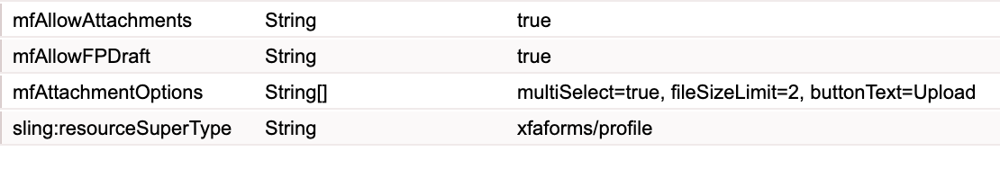

# 为 HTML5 Forms 启用附件功能 {#enabling-attachments-for-an-html-form}

您可以使用HTML5 Forms上传、预览和提交附件。 默认情况下，附件支持处于禁用状态。 要启用附件支持：

1. 创建具有`mfAttachmentOptions`多选字符串属性的[自定义配置文件](/help/forms/using/custom-profile.md)。 `mfAttachmentOptions`属性中的每个字符串必须具有`property=value`格式才能配置文件附件小部件的选项。 `property`和`value`可以具有以下任一值：

   | 属性 | 值 |
   |--- |---|
   | multiSelect | true或false（默认为true） |
   | fileSizeLimit | 以MB为单位的数字（默认为2 MB）。 例如，5。 |
   | 按钮文本 | 弹出窗口的按钮文本（默认为“附加”） |
   | 接受 | 要接受的文件类型的逗号分隔列表（默认为“audio/&amp;ast；， video/&amp;ast；， image/&amp;ast；， text/&amp;ast；， .pdf”） |

   例如：

   

   根据需要，您还可以为`mfAttachmentOptions`属性指定更多自定义选项。

   >[!NOTE]
   >
   >在Microsoft Internet Explorer 9中，用户可以附加大于指定限制的文件。 这是一个已知问题。

1. 使用[元数据编辑器](/help/forms/using/manage-form-metadata.md)选择您在上面为HTML 5表单创建的自定义配置文件。
1. 使用自定义配置文件呈现表单模板，表单工具栏上会显示附件图标。

   >[!NOTE]
   >
   >Forms Portal开箱即用地提供启用了草稿和附件功能的自定义配置文件。 有关&#x200B;**另存为草稿**&#x200B;配置文件的详细信息，请参阅[将HTML5表单另存为草稿](/help/forms/using/saving-html5-form-draft.md)。

1. 单击附件图标，将出现一个附件选择对话框。 浏览并选择附件，然后单击&#x200B;**附加**。

   >[!NOTE]
   >
   >要预览附件，请单击附件名称。

   >[!NOTE]
   >
   >文件预览选项不适用于匿名用户。

## 附件提交格式 {#attachment-submission-format}

启用附件后，HTML5表单提交多部分数据。 多部分提交数据包含两部分&#x200B;**dataXml**&#x200B;和&#x200B;**附件**。

>[!NOTE]
>
>为了向后兼容，如果关闭`mfAllowAttachments`选项，则HTML5表单不会发送多部分数据。 它以&#x200B;**application/xml**&#x200B;格式发送简单数据xml。

如果mfAllowAttachments标志处于打开状态，[提交服务代理服务](/help/forms/using/service-proxy.md)还会发布包含dataXml和附件的多部分数据。
