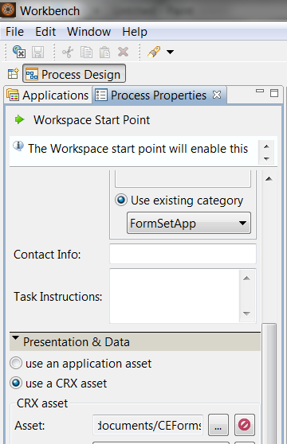
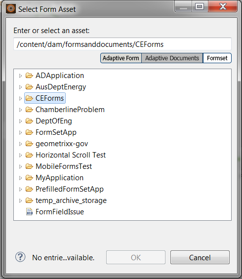
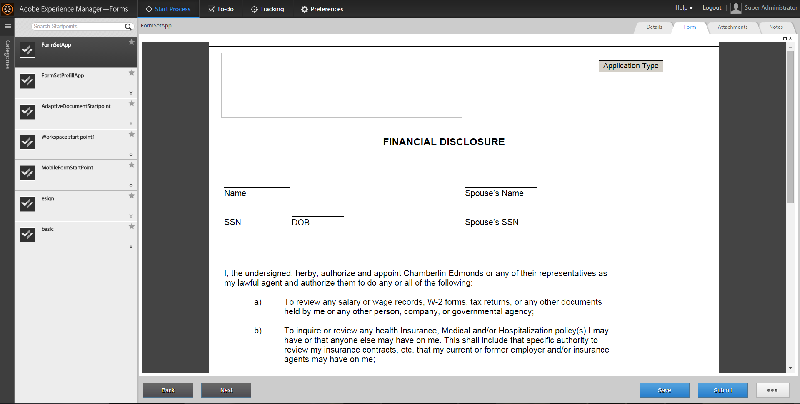

# 在 AEM Forms 工作区中使用表单集{#working-with-formsets-in-aem-forms-workspace}

表单集是HTML5表单的集合，这些表单经过分组，作为一组表单提供给最终用户。 当最终用户开始填写表单集时，他们会无缝地从一个表单转换为另一个表单。 然后，只需一次单击即可提交表单集。 有关表单集以及如何设置表单集的详细信息，请参阅AEM Forms中的[表单集](../../forms/using/formset-in-aem-forms.md)。

AEM Forms工作区支持表单集。 使用表单集，可以分组与服务或流程相关的多个表单以自动化业务流程并向最终用户呈现。 在这样的场景中，用户可以作为一个整体填写整个集合，而无需文件、提交和跟踪单个表单或进程。

## 将表单集附加到AEM Forms工作区应用程序中的起点 {#attaching-a-formset-to-startpoint-in-an-aem-forms-workspace-app-br}

1. 在Workbench中创建业务流程工作流。 有关详细信息，请参阅[Workbench帮助](https://www.adobe.com/go/learn_aemforms_workbench_63)。
1. 从起点的进程属性中，选择&#x200B;**在演示文稿和数据中使用CRX资源**。

   

1. 单击CRX资源路径旁边的 （浏览）。 此时会显示选择表单资源对话框。

   

1. 单击&#x200B;**表单集**&#x200B;选项卡，从列表中选择相关的表单集，然后单击&#x200B;**确定**。

1. 在更新其他相关进程属性之后部署应用程序。

## 使用AEM Forms工作区中的表单集 {#using-formset-in-nbsp-aem-forms-workspace}

将表单集附加到起点后，就可以在AEM Forms工作区中调用该起点，就像调用任何其他起点一样。

通过AEM Forms工作区对表单集支持的操作包括：

* 另存为草稿
* 锁定
* 放弃
* 提交
* 添加附件
* 添加注释
* 使用“上一步”或“下一步”按钮在表单集中的表单之间移动

>[!NOTE]
>
>为了在表单集中从上一个和下一个表单移动期间提高性能，在相关表单完全呈现之前，将禁用所有工作区按钮(“返回”、“下一个”、“保存”、“提交”和…… （更多）)。
