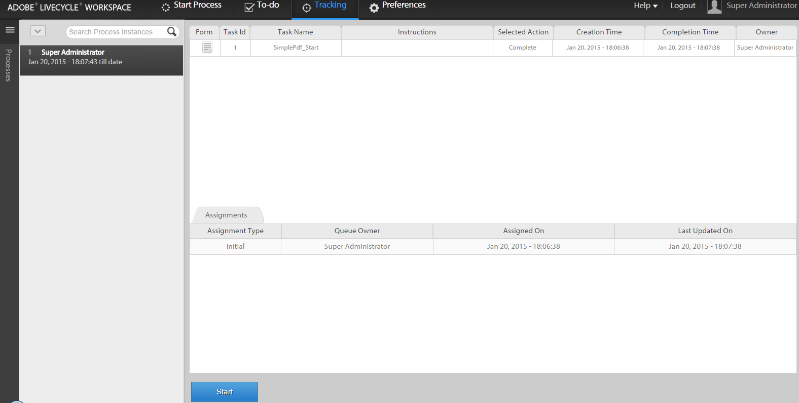
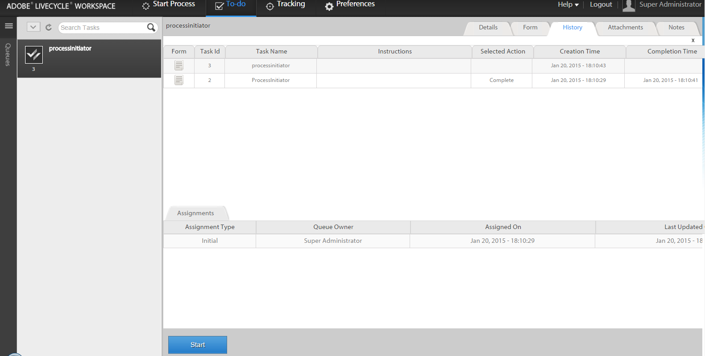

# 在 AEM Forms 工作区中使用现有流程数据启动新流程{#initiating-a-new-process-with-existing-process-data-in-aem-forms-workspace}

您可以使用现有流程数据启动新流程。 当我们必须频繁使用相同的表单而几乎不改变内容（如付费休假表单的内容）时，就需要从现有的流程数据启动新的流程。 此功能可节省用户的时间和精力，尤其是在流程需要填写较长的表单时。

以下是从现有流程数据启动新流程的步骤：-

1. 执行下列操作之一：

   * 在跟踪中，单击要使用其数据的流程实例。 从右侧窗格的“进程历史记录”视图中，单击与起始点对应的任务行。
   * 在跟踪中，选择一个搜索模板以显示流程实例列表。 选择要使用其数据的实例。
   * 在&#x200B;**[!UICONTROL 待办事项]**&#x200B;选项卡中，选择任务。 单击&#x200B;**[!UICONTROL 历史记录]**&#x200B;选项卡，然后选择启动进程实例的任务。

    

1. 在“任务”操作工具栏中，单击&#x200B;**[!UICONTROL 开始]**。 此时将显示新流程实例的自适应表单，其中预填了数据。

1. 根据需要更新数据，然后单击&#x200B;**[!UICONTROL 完成]**&#x200B;或表单上的相应按钮。
