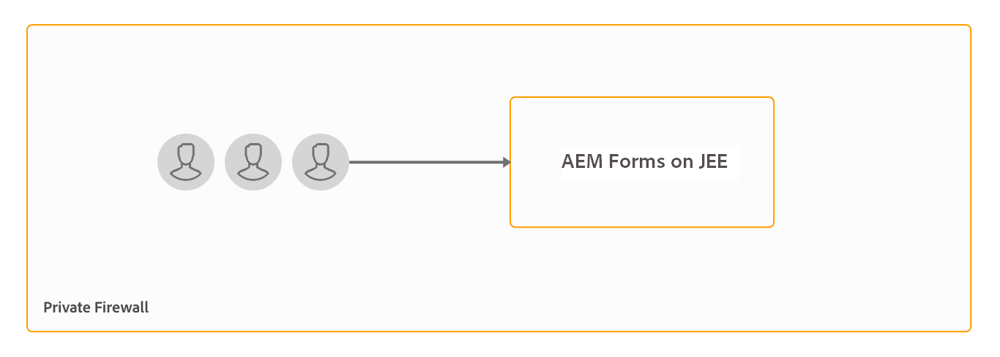
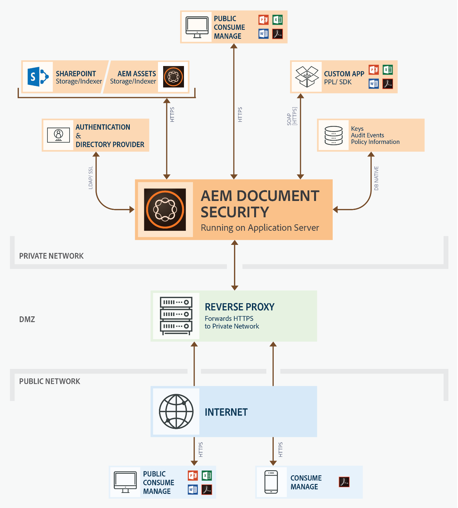

# 安装和配置Document Security服务器 {#installing-and-configuring-the-document-security-server}

使用Document Security安全地分发您以支持的格式保存的任何信息。 只有授权用户可以访问受保护的文档。

Adobe Experience Manager Forms document security确保只有授权用户才能使用您的文档。 使用Document Security，您可以安全地分发以支持的格式保存的任何信息。 支持的文件格式包括Adobe可移植文档格式(PDF)以及Microsoft Word、Excel和PowerPoint文件。

您可以使用策略保护文档。 您在策略中指定的机密性设置确定收件人如何使用您应用策略的文档。 例如，您可以指定收件人是否可以打印或复制文本、编辑文本或者向受保护文档添加签名和注释。

策略存储在Document Security服务器上；您可以通过客户端应用程序将策略应用到文档。 将策略应用到文档时，策略中指定的机密性设置保护文档包含的信息。 您可以将受策略保护的文档分发给策略授权的收件人。

Document Security还提供了客户端、查看者和索引器来保护文档、查看受保护的文档以及编制受保护的文档索引。 有关Document Security的详细信息，请参阅[关于Document Security](/help/forms/using/admin-help/document-security.md)。

## 部署拓扑  {#deployment-topology}

文档安全功能仅在AEM Forms on JEE中可用。 您需要JEE上的单个AEM Forms实例。 如有必要，您还可以创建AEM Forms服务器的群集或场。 以下拓扑是运行Document Security功能的指示拓扑。 有关拓扑的详细信息，请参阅[AEM Forms的架构和部署拓扑](aem-forms-architecture-deployment.md)。

<!--fix above link-->

下图显示了AEM Forms Document Security的典型架构：

## 在JEE上安装AEM Forms {#installing-aem-forms-on-jee}

执行以下步骤以在JEE上安装和配置AEM Forms：

1. 从[AEM授权网站(LWS)](https://licensing.adobe.com/)下载JEE上的Adobe 6.5 Forms安装程序。 您需要有效的维护和支持合同才能下载安装程序。
1. 阅读[JEE支持的AEM Forms文档](/help/forms/using/aem-forms-jee-supported-platforms.md)，并确保已准备好在JEE上安装AEM Forms的软件、硬件、操作系统、应用程序服务器、数据库、JDK和其他基础架构。
1. （仅限非Turnkey安装）阅读[准备安装AEM Forms单服务器](https://www.adobe.com/go/learn_aemforms_prepareInstallsingle_64)或[准备安装AEM Forms服务器群集](https://www.adobe.com/go/learn_aemforms_prepareInstallcluster_64)，并准备好环境在JEE上安装和配置AEM Forms。
1. 根据您的环境和应用程序服务器，选择以下文档之一并按照说明完成安装

   * [使用JBoss全包在JEE上安装和部署AEM Forms](https://www.adobe.com/go/learn_aemforms_installTurnkey_64)
   * [在JEE for JBoss上安装和部署AEM Forms](https://www.adobe.com/go/learn_aemforms_installJBoss_64)
   * [在JEE for WebLogic上安装和部署AEM Forms](https://www.adobe.com/go/learn_aemforms_installWebLogic_64)
   * [在JEE for WebSphere上安装和部署AEM Forms](https://www.adobe.com/go/learn_aemforms_installWebSphere_64)
   * [在JBoss集群上的JEE上配置AEM Forms](https://www.adobe.com/go/learn_aemforms_clusterJBoss_64)
   * [在WebLogic群集上的JEE上配置AEM Forms](https://www.adobe.com/go/learn_aemforms_clusterWebLogic_64)
   * [在WebSphere群集上的JEE上配置AEM Forms](https://www.adobe.com/go/learn_aemforms_clusterWebSphere_64)

   >[!NOTE]
   >
   >在JEE配置管理器上的AEM Forms的模块选择屏幕上，选择Document Security选项。 Document Security选项不需要选择任何其他模块。

## 后续步骤 {#next-steps}

* [配置客户端和服务器选项](/help/forms/using/admin-help/configuring-client-server-options.md)
* [创建和管理策略](/help/forms/using/admin-help/creating-policies.md)
* [创建和管理策略集](/help/forms/using/admin-help/creating-policy-sets.md)
