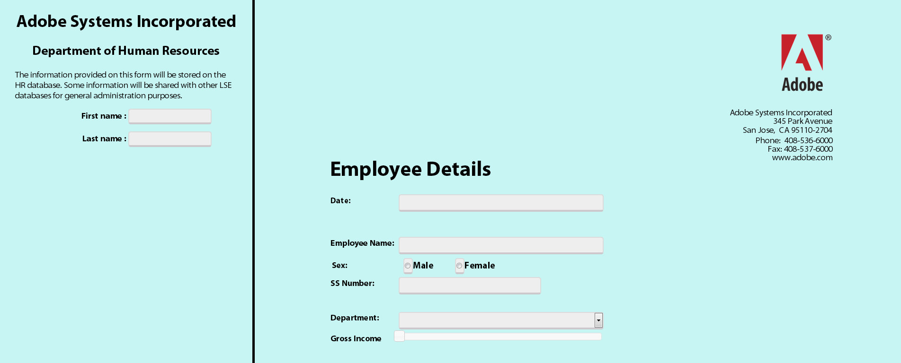

# 将 Form Bridge 集成至 HTML5 Forms 的自定义门户中{#integrating-form-bridge-with-custom-portal-for-html-forms}

FormBridge是一个HTML5 Forms Bridge API，它允许您与表单交互。 有关FormBridge API引用，请参阅[FormBridge API引用](/help/forms/using/form-bridge-apis.md)。

您可以使用FormBridge API从HTML页面获取或设置表单字段的值并提交表单。 例如，您可以使用API构建类似于向导的体验。

现有的HTML应用程序可以使用FormBridge API与表单进行交互并将其嵌入到HTML页面中。 您可以使用以下步骤通过Form Bridge API设置字段的值。

## 将HTML5 Forms集成到网页 {#integrating-html-forms-to-a-web-page}

1. **选择配置文件或创建配置文件**

   1. 在CRX DE界面中，导航到： `https://'[server]:[port]'/crx/de`。
   1. 使用管理员凭据登录。
   1. 创建配置文件或选择现有配置文件。

      有关如何创建配置文件的详细信息，请参阅[创建配置文件](/help/forms/using/custom-profile.md)。

1. **修改HTML配置文件**

   在配置文件渲染器中包含XFA运行时、XFA区域设置库和XFA表单HTML片段，设计您的网页，并将表单放入网页中。

   例如，使用以下代码片断，创建一个包含两个输入字段的应用程序，并创建一个表单以演示表单与外部应用程序之间的交互。

   ```xml
   <%@ page session="false"
                  contentType="text/html; charset=utf-8"%><%
   %><%@ taglib prefix="cq" uri="https://www.day.com/taglibs/cq/1.0" %><%
   %><!DOCTYPE html>
   <html manifest="${param.offlineSpec}">
       <head>
          <cq:include script="formRuntime.jsp"/>
           <!-- Portal Scripts and Styles -->
          <cq:include script="portalheader.jsp"/>
       </head>
       <body>
           <div id="leftdiv" >
               <div id="leftdivcontentarea">
                   <!-- Portal Body -->
                 <cq:include script="portalbody.jsp"/>
               </div>
           </div>
           <div id="rightdiv">
               <div id="formBody">
               <cq:include script="config.jsp"/>
               <!-- Form body -->
               <cq:include script="formBody.jsp"/>
               <!  --To assist in page transitions -- add navigation, based on scrolling -->
               <cq:include  script="../nav/scroll/nav_footer.jsp"/>
               <cq:include script="footer.jsp"/>
               </div>
           </div>
       </body>
   </html>
   ```

   >[!NOTE]
   >
   >**第9**&#x200B;行，包含用于CSS样式和JavaScript文件的附加JSP引用以设计页面。
   >
   >
   >**第18**&#x200B;行上的&lt;div id=&quot;rightdiv&quot;>标记包含XFA表单的HTML代码片段。
   >
   >
   >页面样式为两个容器：**left**&#x200B;和&#x200B;**right**。 正确的容器具有表单。 左侧容器包含两个输入字段和一个外部HTML页面的一部分。
   >
   >
   >以下屏幕抓图显示了表单在浏览器中的显示方式。

   

   左侧是&#x200B;**HTML页面**&#x200B;的一部分。 包含字段的右侧是&#x200B;**xfa表单**。

1. **从页面访问表单字段**

   以下是示例脚本，您可以添加此脚本来设置表单字段中的值。

   例如，如果要使用&#x200B;**名字**&#x200B;和&#x200B;**姓氏**&#x200B;字段中的值设置&#x200B;**雇员姓名**，请调用&#x200B;**window.formBridge.setFieldValue**&#x200B;函数。

   同样，可以通过调用&#x200B;**window.formBridge.getFieldValue** API读取该值。

   ```javascript
   $(function() {
               $(".input").blur(function() {
                   window.formBridge.setFieldValue(
                               'xfa.form.form1.#subform[0].EmployeeName',
                                $("#lname").val()+' '+$("#fname").val()
                              )
                   });
           });
   ```
