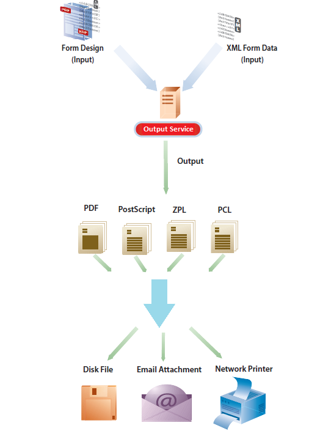

# 输出服务{#output-service}

## 概述 {#overview}

输出服务是AEM Document Services中的OSGi服务。 输出服务支持AEM Forms Designer的各种输出格式和输出设计功能。 输出服务可以转换XFA模板和XML数据以生成各种格式的打印文档。

Output 服务使您能够创建应用程序，这些应用程序允许您：

* 使用 XML 数据填充模板文件来生成最终表单文档。
* 生成各种格式的输出表单，包括非交互式PDF、PostScript、PCL和ZPL打印流。
* 从 XFA 表单 PDF 生成打印 PDF。
* 通过将多组数据与提供的模板合并，批量生成PDF、PostScript、PCL和ZPL文档。

>[!NOTE]
>
>输出服务是32位应用程序。 在Microsoft Windows上，允许32位应用程序使用最多2 GB的内存。 该限制也适用于输出服务。

## 创建非交互式表单文档 {#creating-non-interactive-form-documents}

通常，您可以使用AEM Forms Designer创建模板。 Output服务的`generatePDFOutput`和`generatePrintedOutput` API允许您直接将这些模板转换为各种格式，包括PDF、PostScript、ZPL和PCL。

`generatePDFOutput`操作生成PDF，而`generatePrintedOutput`操作生成PostScript、ZPL和PCL格式。 这两个操作的第一个参数接受模板文件的名称（例如，`ExpenseClaim.xdp`）或包含该模板的Document对象。 指定模板文件的名称时，还应指定内容根目录作为包含模板的文件夹的路径。 您可以使用`PDFOutputOptions`或`PrintedOutputOptions`参数指定内容根。 有关可以使用这些参数指定的其他选项的详细信息，请参阅Javadoc 。

第二个参数在生成输出文档时接受与模板合并的XML文档。

`generatePDFOutput`操作还可以接受基于XFA的PDF表单作为输入，并返回PDF表单的非交互版本作为输出。

## 生成非交互式表单文档 {#generating-non-interactive-form-documents}

假设您有一个或多个模板，并且每个模板有多个XML数据记录。

使用Output服务的`generatePDFOutputBatch`和`generatePrintedOutputBatch`操作为每个记录生成打印文档。

您还可以将记录合并到单个文档中。 这两个操作都需要4个参数。

第一个参数是一个Map ，它包含作为键的任意字符串和作为值的模板文件名称。

第二个参数是不同的Map，其值是包含XML数据的Document对象。 该键与为第一个参数指定的键相同。

`generatePDFOutputBatch`或`generatePrintedOutputBatch`的第三个参数分别为类型`PDFOutputOptions`或`PrintedOutputOptions`。

参数类型与`generatePDFOutput`和`generatePrintedOutput`操作的参数类型相同，具有相同的效果。

第四个参数是`BatchOptions`类型，您可以使用它来指定是否可以为每个记录生成单独的文件。 此参数的默认值为false。

`generatePrintedOutputBatch`和`generatePDFOutputBatch`都返回类型`BatchResult`的值。 该值包含生成的文档列表。 它还包含一个XML格式的元数据文档，其中包含与生成的每个文档相关的信息。
