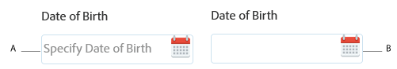

# AEM Forms 中的占位符文本 {#placeholder-text-in-aem-forms}

Adobe 建议使用现代、可扩展的数据捕获[核心组件](https://experienceleague.adobe.com/docs/experience-manager-core-components/using/adaptive-forms/introduction.html?lang=zh-Hans)，以[创建新的自适应表单](/help/forms/using/create-an-adaptive-form-core-components.md)或[将自适应表单添加到 AEM Sites 页面](/help/forms/using/create-or-add-an-adaptive-form-to-aem-sites-page.md)。 这些组件代表了自适应表单创建方面的一大进步，可确保提供令人印象深刻的用户体验。 本文介绍了使用基础组件创作自适应表单的旧方法。

占位符文本表示一个单词或短语。 它旨在帮助用户在控件没有值时输入数据。 占位符文本可以是示例值，也可以是预期格式的简短描述。 占位符文本在用户输入值之前显示，当用户输入或选择值时会被删除。

>[!NOTE]
>
>占位符文本（如果已指定）必须具有不包含新行字符的值。

**A.**&#x200B;带有占位符文本的日期组件&#x200B;**B.**&#x200B;不带占位符文本的日期组件

AEM Forms支持密码框、日期选取器、数字框和文本框字段的占位符文本。\
本地HTML5日期小组件不支持占位符文本。 要指定占位符文本，请执行以下操作：

1. 右键单击支持占位符文本的组件，然后单击&#x200B;**编辑**。 将出现“编辑组件”对话框。

1. 打开&#x200B;**标题和文本**&#x200B;选项卡。
1. 在&#x200B;**占位符文本框**&#x200B;中指定单词或短语。 单击&#x200B;**确定**。

>[!NOTE]
>
>Microsoft Internet Explorer 9不支持占位符文本。
