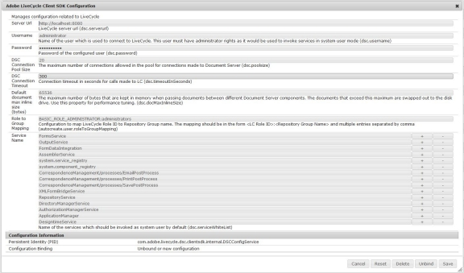
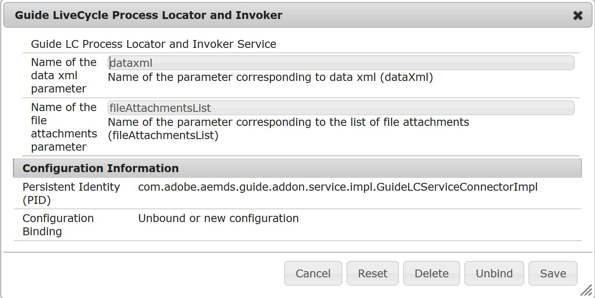

# 在JEE流程中配置AEM Forms以将表单数据提交到AEM表单{#configuring-aem-forms-to-submit-form-data-to-an-aem-forms-on-jee-process}

自适应表单支持将数据提交到AEM Forms on JEE流程以进行进一步处理。 它允许您使用已提交表单中可用的数据触发AEM Forms on JEE流程。 执行以下步骤，以便您可以启用AEM Forms实例将自适应表单提交到AEM Forms on JEE流程：

## 配置AEM Forms服务器 {#configure-your-aem-forms-server}

执行以下步骤，以便您可以启用AEM Forms服务器将数据提交到JEE服务器上的AEM Forms：

1. 转到https://[*host*]：[*port*]/system/console/configMgr上的AEM Web配置控制台。

1. 找到并单击&#x200B;**Adobe LiveCycle Client SDK配置**&#x200B;组件。
1. 单击以编辑AEM Forms on JEE服务器的配置服务器URL、用户名和密码。
1. 查看设置并单击&#x200B;**保存**。

## 使用流程字段映射数据 {#map-data-with-process-fields}

配置AEM Forms后，将提交表单中的数据XML和附件映射到AEM Forms on JEE流程中的字段。 执行以下操作：

1. 在AEM Web配置控制台中，单击以编辑&#x200B;**Guide LiveCycle Process Locator and Invoker**&#x200B;配置。
1. 指定以下参数：

   * **数据xml参数的名称**（必需）：指定必须处理提交数据的AEM Forms on JEE进程的XML属性文件。 默认值为&#x200B;**dataxml**。

   * **文件附件参数的名称**（可选）：指定AEM Forms on JEE进程必须处理的文档对象列表。 默认值为&#x200B;**fileAttachmentsList**。

1. 查看设置并单击&#x200B;**保存**。

配置完毕后，提交到Forms Workflow提交操作会列出包含指定数据xml参数的JEE服务器进程上的AEM Forms 。
