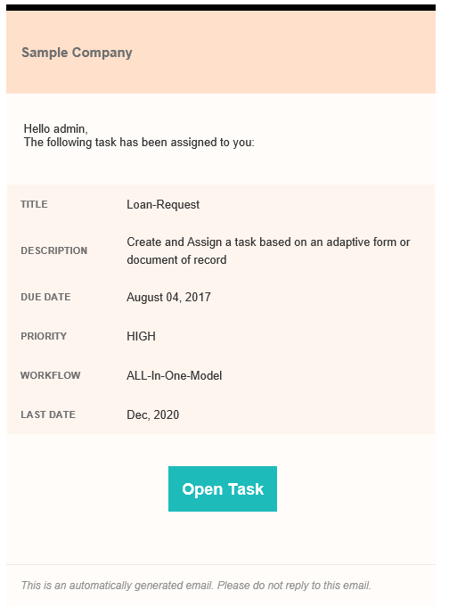
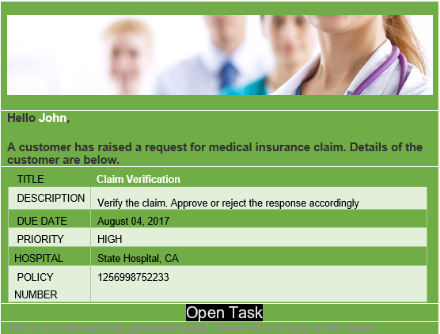

# 在“分配任务”步骤中使用自定义电子邮件模板{#use-custom-email-templates-in-an-assign-task-step}

您可以使用“分配任务”步骤来创建任务并将其分配给用户或组。 将任务分配给用户或组时，会向定义的用户或定义的组的每个成员发送电子邮件通知。 典型的电子邮件通知包含已分配任务的链接以及与该任务相关的信息。 下图显示了一个示例电子邮件通知：

您可以自定义外观，并在电子邮件通知中使用自定义元数据。 AEM Forms为电子邮件通知提供了一个现成的模板。 您可以自定义现成模板或从头开始创建模板。

电子邮件通知模板基于[HTML电子邮件](https://en.wikipedia.org/wiki/HTML_email)。 这些电子邮件可适应不同的电子邮件客户端和屏幕大小。 此外，电子邮件的样式在模板中定义。

下图显示了自定义的电子邮件通知：

## 自定义现有模板 {#customize-the-existing-template}

AEM Forms开箱即用地提供电子邮件通知模板。 模板提供已分配任务的标题描述、截止日期、优先级、工作流名称和链接。 可以自定义模板以更改外观。 执行以下步骤以自定义模板：

1. 使用管理员帐户登录CRXDE。

1. 导航到/libs/fd/dashboard/templates/email。

1. 打开htmlEmailTemplate.txt文件。 它包含默认模板。

1. 将htmlEmailTemplate.txt文件的内容替换为自定义内容。

   电子邮件通知模板是[HTML电子邮件](https://en.wikipedia.org/wiki/HTML_email)。 您可以使用自定义代码替换现有的html代码以更改模板的外观。

1. 保存该文件。 现在，自定义模板已可供使用。

## 创建电子邮件模板 {#create-an-email-template}

AEM Forms开箱即用地提供电子邮件通知模板。 模板提供已分配任务的标题描述、截止日期、优先级、工作流名称和链接。 您还可以为分配任务步骤添加自定义电子邮件模板（您自己的模板）。 执行以下步骤以添加自定义电子邮件模板：

1. 使用管理员帐户登录CRXDE。

1. 导航到/libs/fd/dashboard/templates/email。

1. 创建.txt文件。 例如，EmailOnTaskAssign.txt。

1. 将自定义HTML代码添加到该文件中。

   电子邮件通知模板是[HTML电子邮件](https://en.wikipedia.org/wiki/HTML_email)。 您可以向文件中添加自定义HTML代码以创建模板。

1. 保存该文件。 该模板可以在“分配任务”步骤中使用。

## 在“分配任务”步骤中使用电子邮件模板 {#use-an-email-template-in-an-assign-task-step}

开箱即用的分配任务步骤配置为使用默认模板htmlEmailTemplate.txt。 您可以选择使用自定义模板。 要更改模板，请执行以下操作：

1. 打开“分配任务”步骤。

1. 导航到“被分派人”>“HTML电子邮件模板”。

1. 选择新创建的HTML电子邮件模板。

1. 单击“确定”。 模板已更改。

电子邮件通知也使用[元数据](../../forms/using/use-metadata-in-email-notifications.md)。 例如，到期日期、优先级、工作流名称等。 您还可以将模板配置为使用[自定义元数据](../../forms/using/use-metadata-in-email-notifications.md#using-custom-metadata-in-an-email-notification)。
