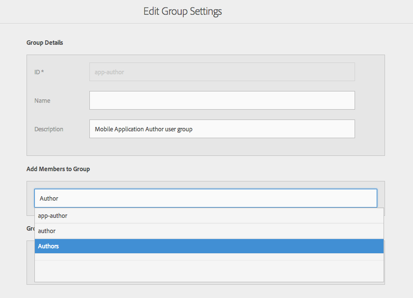
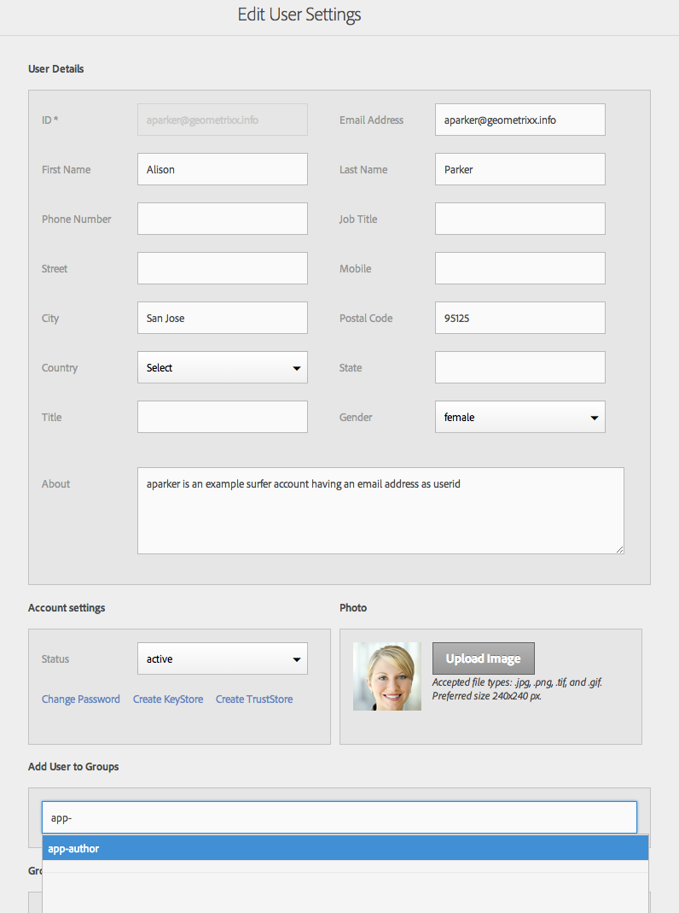
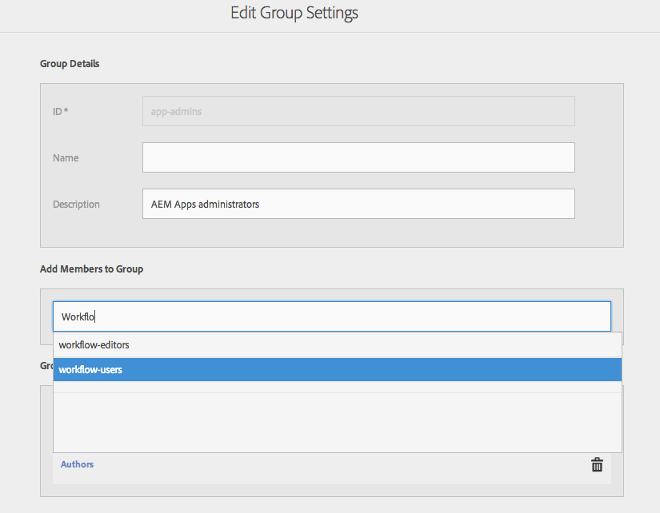
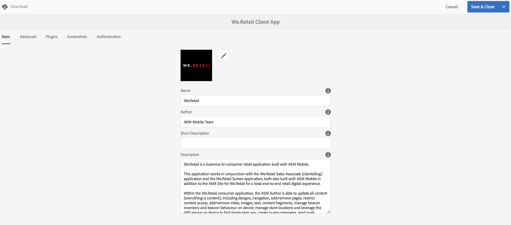

# 配置用户和用户组 {#configure-your-users-and-user-groups}

{{ue-over-mobile}}

本章介绍用户角色以及如何配置用户和组以支持移动设备应用程序的创作和管理。

## AEM Mobile应用程序用户和组管理 {#aem-mobile-application-users-and-group-administration}

为帮助组织和管理AEM应用程序的权限模型，提供了以下两个组：

* 面向应用程序管理员的应用程序管理员
* 面向应用程序作者的应用程序作者

### AEM Mobile应用程序内容作者（应用程序创作组） {#aem-mobile-application-content-authors-app-author-group}

应用程序创作组成员负责创作AEM移动应用程序内容，包括页面、文本、图像和视频。

#### 组配置 — 应用程序作者 {#group-configuration-app-authors}

1. 创建一个名为“应用程序作者”的用户组：

   导航到用户Admin Console： [http://localhost:4502/libs/granite/security/content/groupadmin.html](http://localhost:4502/libs/granite/security/content/groupadmin.html)

   在用户组控制台中，选择“+”按钮以创建组。

   将此组的ID设置为“应用程序作者”，表示它是特定类型的创作用户组，特定于AEM中创作移动设备应用程序。

1. 将成员添加到组：作者

   

   将应用程序作者添加到“作者”组

1. 现在您已创建应用程序作者用户组，可以通过[用户Admin Console](http://localhost:4502/libs/granite/security/content/useradmin.md)将个别团队成员添加到此新组。

   

   编辑用户组

1. 导航到[权限控制台](http://localhost:4502/useradmin)并添加权限以管理cloudservices

   * /etc/cloudservices上的（读取）

   >[!NOTE]
   >
   >应用程序作者扩展了AEM中的默认内容作者（作者）组，以便他们能够在/content/phonegap下创建内容

### AEM Mobile应用程序管理员组（app-admins组） {#aem-mobile-application-administrators-group-app-admins-group}

应用程序管理员组的成员可以使用与应用程序作者&#x200B;**和**&#x200B;相同的权限创作应用程序内容，此外，他们还负责：

* 在AEM中配置PhoneGap Build和Adobe Mobile Services云服务
* 暂存、发布和清除应用程序内容同步OTA更新

>[!NOTE]
>
>权限决定AEM应用程序命令中心中某些用户操作的可用性。
>
>请注意，某些选项不适用于可供应用程序管理员使用的应用程序作者。

#### 组配置 — 应用程序管理员 {#group-configuration-app-admins}

1. 创建一个名为app-admins的组。
1. 将以下组添加到新的app-admins组：

   * content-authors
   * workflow-users

   

1. 导航到[权限控制台](http://localhost:4502/useradmin)并添加权限以管理cloudservices

   * （读取、修改、创建、删除、复制）
   * （读取、修改、创建、删除、复制）

1. 在相同的“权限”控制台上，为暂存、发布和清除应用程序内容更新添加权限

   * （读取、修改、创建、删除、复制）
   * /var/contentsync上的（读取）

   >[!NOTE]
   >
   >包复制用于将应用程序更新从创作实例发布到发布实例

   >[!CAUTION]
   >
   >/var/contentsync访问被拒绝为开箱即用。
   >
   >省略READ权限可能会导致生成和复制空的更新包。

1. 根据需要向此组添加成员

## 功能板拼贴权限 {#dashboard-tile-permissions}

仪表板磁贴可能会根据用户拥有的权限公开不同的操作。 下面描述了每个图块可用的操作。

除了这些权限之外，还可以根据当前应用程序的配置方式显示/隐藏操作。 例如，如果尚未将PhoneGap云配置分配给应用程序，则没有必要公开“远程构建”操作。 下面的“**配置条件**”部分列出了这些条件。

### 管理应用程序磁贴 {#manage-app-tile}

图块当前没有需要权限的操作，但应用程序的详细信息页面具有以下操作：

* 在/content/phonegap/{suffix}上编辑app-author和app-admin的&#x200B;*Edit* （UI触发器 — jcr:write）
* *下载app-author和app-admin的* （UI触发器 — 位于/content/phonegap/{suffix}）

下图显示了应用程序的“下载”和“编辑”选项：

