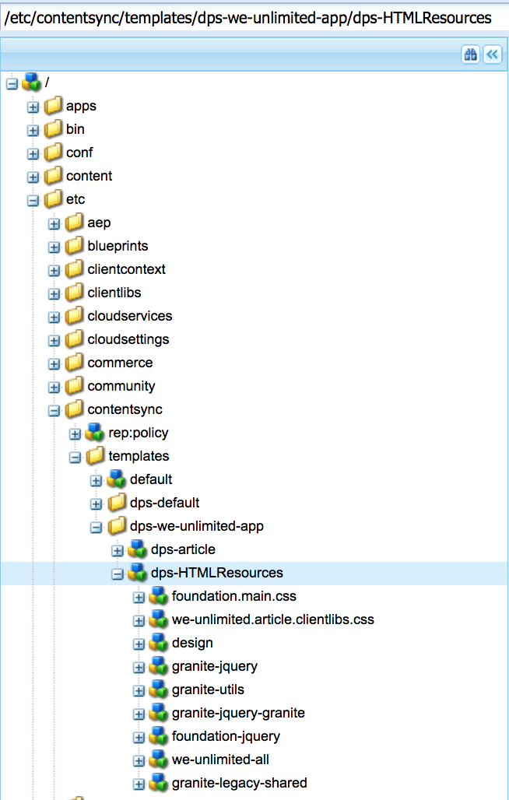

# 创建共享资源导出配置{#creating-shared-resources-export-configuration}

{{ue-over-mobile}}

>[!CAUTION]
>
>**预修课程**：
>
>在了解如何创建和修改共享资源之前，请参阅[内容同步](/help/mobile/mobile-ondemand-contentsync.md)以了解基本概念。

Adobe Experience Manager (AEM) Mobile用户使用Content Sync将实时内容导出到静态内容，以供在移动设备应用程序中使用，当内容从AEM Mobile上传到Mobile On-Demand Services时，会发生此导出。

上表中提到的属性&#x200B;***dps-exportTemplate***&#x200B;定义了应用程序导出配置的路径。 设置此属性以创建和修改共享资源。

以下资源介绍了从AEM导出共享资源以供上传到AEM Mobile。

共享的HTML资源允许文章共享在其他情况下所有文章都将重复的HTML资源，并且可以包含图标、字体、JavaScript和css。

在&#x200B;**&lt;dps-exportTemplate>/dps-HTMLResources>**&#x200B;找到的内容同步配置应配置为导出设备上属性静态呈现所需的所有内容和项目。

>[!CAUTION]
>
>只有在具备以下条件时，您才可以执行以下步骤来查看共享资源的示例：
>
>* 已安装示例内容
>* 运行AEM实例
>* 没有已配置的自定义上下文或其他端口
>

要查看共享资源的示例，请参阅以下步骤：

1. 在AEM服务器上打开CRXDE Lite。
1. 浏览到此路径&#x200B;*[/etc/contentsync/templates/dps-we-unlimited-app/dps-HTMLResources](http://localhost:4502/crx/de/index.jsp#/etc/contentsync/templates/dps-we-unlimited-app/dps-HTMLResources)*，以查看共享资源示例。

   您可以查看创建共享资源所需的所有属性，如下图所示：

   

>[!NOTE]
>
>当任何共享资源发生更改时，应将共享资源上传或导出到AEM Mobile On-demand Services。
