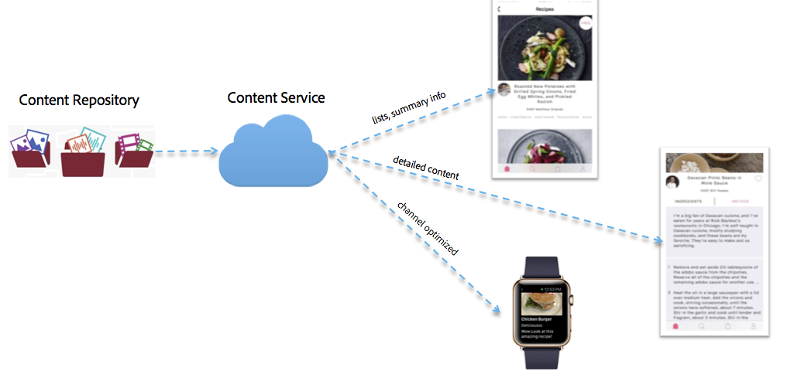

# 内容服务{#content-services}

{{ue-over-mobile}}

>[!CAUTION]
>
>仅出于预览目的，介绍了内容服务功能。
>
>此版本可能会随6.3 Service Pack 1的发布而更改。

AEM Mobile Content Services是一项轻量级功能，用于请求由AEM管理的内容。 这为所有应用程序开发人员提供了一种高性能的方法，无需深入了解AEM的内容存储库(JCR)和Web框架(Sling)，即可检索内容。 它允许请求应用程序与内容存储库分离。

Content Services引入了几个新的AEM结构，这些结构允许开发人员访问AEM管理的内容，而无需了解该内容的存储库结构。

这些构建对于保持灵活性以及通过在由AEM管理的内容和使用内容的移动应用程序之间提供一个抽象层来实现未来扩展是必需的。 这使得AEM Content Services能够充当本机应用程序的内容需求与AEM内容存储库之间的抽象层。

Content Services可以将内容作为资产、打包的HTML (HTML/CSS/JS)或独立于渠道的内容来交付。

>[!CAUTION]
>
>**先决条件：**
>
>在开始使用Content Services之前，请确保启用Content Services标志。 要在应用程序中启用模型的创建和管理，请在配置浏览器中启用数据模型。
>
>有关详细信息，请参阅&#x200B;**[管理内容服务](/help/mobile/developing-content-services.md)**&#x200B;和[配置浏览器](/help/sites-administering/configurations.md)文档。

设置Content Services标记并在配置浏览器中启用数据模型后，请参阅以下资源以开始使用AEM Mobile Content Services。 熟悉Content Services概念，如模型管理、实体管理，然后是AEM Mobile Content Services的内容交付/渲染。

* 存储库中的模型
* 呈现和交付
