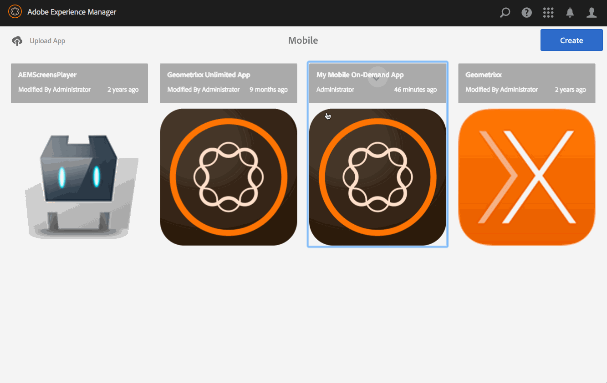

# 发布取消发布内容{#publish-unpublish-content}

{{ue-over-mobile}}

熟悉关于文章、横幅和收藏集的内容管理操作后，即可发布您的内容。 您还可以取消发布内容。

>[!NOTE]
>
>要详细了解AEM Mobile应用程序的设计注意事项，请参阅联机帮助中的[AEM Mobile应用程序的设计注意事项](https://helpx.adobe.com/digital-publishing-solution/help/aem-mobile-end-of-life-faq.html)。

## 发布/取消发布内容 {#publishing-unpublishing-the-content}

这不同于“AEM发布”。 您不会将内容推送到AEM发布服务器实例以使内容可公开查看。 在此，您正在通知Mobile On-Demand选定的内容应在实时Mobile On-Demand应用程序中公开。

>[!NOTE]
>
>内容必须先上传到Mobile On-Demand，然后才能发布。

用于发布/取消发布文章的常规工作流：

1. 在Mobile中，从目录中选择您的Mobile On-Demand应用程序。
1. 选择文章。
1. 如果需要，可从列表视图添加其他文章。
1. 从操作栏中选择发布。 片刻后，您的文章将公开。
1. 使用上述相同步骤取消发布发布文章。

<!--
FAIL >>[!NOTE]
>
>Generally, you should preflight before publishing. See [Previewing with Preflight](/content/docs/en/aem/6-3/administer/mobile-apps/aem-mobile/previewing-with-preflight-on-demand-services.md) for more details.
-->

### 后续步骤 {#the-next-steps}

了解如何创建和发布内容后，请参阅以下内容：

* [为AEM Mobile On-demand Services开发AEM内容](/help/mobile/aem-mobile-on-demand.md)
* [管理内容以使用AEM Mobile On-demand Services](/help/mobile/aem-mobile.md)

或者，如果您仍想了解有关创作主题的更多信息，请参阅[为AEM Mobile On-demand Services应用程序创作AEM内容](/help/mobile/mobile-apps-ondemand.md)。
