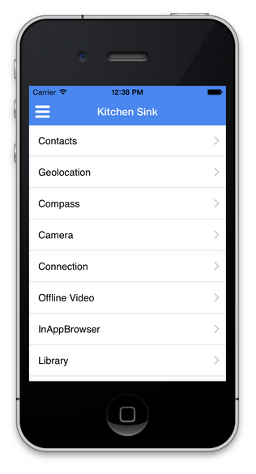

# 访问设备功能{#access-device-features}

{{ue-over-mobile}}

## 构建访问设备功能的Adobe Experience Manager (AEM)组件 {#building-aem-components-that-access-device-features}

[AEM PhoneGap Kitchen Sink](https://github.com/blefebvre/aem-phonegap-kitchen-sink) GitHub存储库为开发人员提供了一个功能强大的AEM应用程序，该应用程序展示了几个核心Cordova API的使用。 在通过PhoneGap CLI在iOS或Android™上运行时，该应用程序会打开到以下页面，其中包括到它演示的每个设备API的链接：

这些设备API组件的源代码在GitHub](https://github.com/blefebvre/aem-phonegap-kitchen-sink/tree/master/content/src/main/content/jcr_root/apps/brucelefebvre/kitchen-sink/components)上为[。

有关每个API用法的更多详细信息，请参阅Cordova插件文档(`https://docs.phonegap.com/en/4.0.0/cordova_plugins_pluginapis.md.html`)。

## 后续步骤 {#the-next-steps}

查看[使用Adobe Mobile Analytics跟踪应用程序性能](/help/mobile/phonegap-intro-to-app-analytics.md)。
