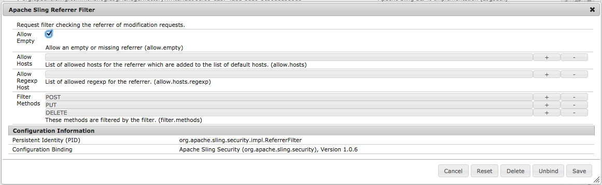

# 将反向链接筛选条件设置为允许为空{#setting-your-referrer-filter-to-allow-empty}

{{ue-over-mobile}}

要允许Adobe Experience Manager (AEM)移动应用程序查看器查看创作实例上的应用程序，您必须将HTML反向链接筛选条件设置为“允许为空”。

如果您不打算使用Application Viewer来查看处于开发和暂存状态的应用程序，则无需更改反向链接筛选器的默认设置。

在正在运行的AEM创作实例中，导航到[http://localhost:4502/system/console/configMgr](http://localhost:4502/system/console/configMgr)并搜索“Apache Sling引用过滤器”。 单击以编辑反向链接筛选条件，并选中“允许为空”复选框（请参阅下图）。 接下来，点击“保存”按钮并关闭浏览器页面。

