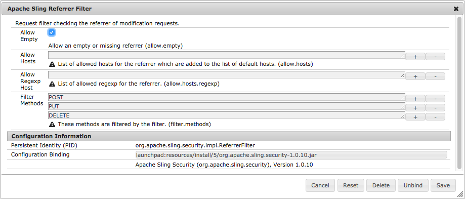

# 为 AEM 应用程序进行配置{#configuring-for-aem-apps}

Adobe Experience Manager应用程序允许您更新应用程序OTA的内容（空中）。 更新的内容存储在发布实例上。 要允许设备上的应用程序连接到发布实例并检查更新，必须将发布实例配置为允许空的反向链接标头。

## 配置空反向链接标头 {#configuring-empty-referrer-header}

要配置反向链接过滤器服务：

* 在以下地址打开 Apache Felix 控制台（**配置**）：
* https://<服务器>：<端口号>/system/console/configMgr
* 以管理员身份登录。
* 在&#x200B;**配置**&#x200B;菜单中，选择： *Apache Sling引用过滤器*
* 选中允许空字段，以便您可以允许为空/缺少反向链接标头。
* 单击&#x200B;**保存**&#x200B;以保存更改。

有关更多详细信息，请参阅[OSGI配置设置](/help/sites-deploying/osgi-configuration-settings.md)和[安全核对清单 — 跨站点请求伪造问题](/help/sites-administering/security-checklist.md#protect-against-cross-site-request-forgery)。
