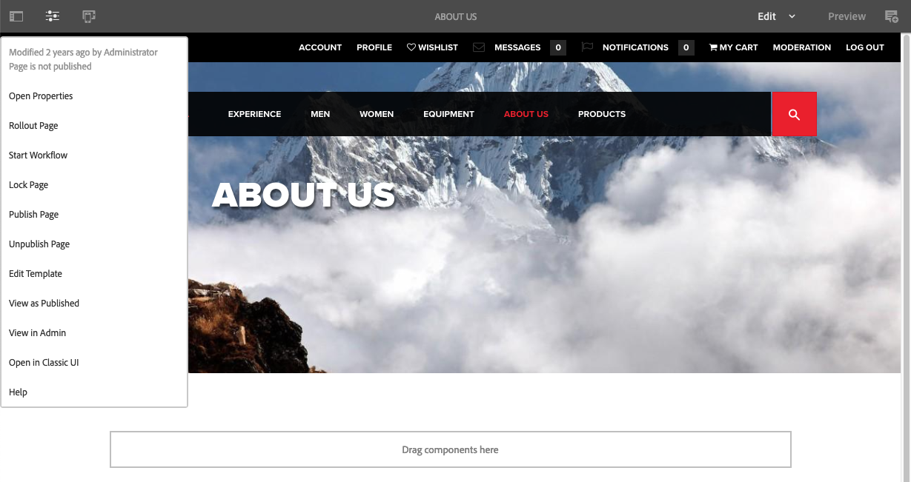

# 编辑器{#editor}

默认情况下，已禁用从编辑器切换到经典UI的功能。

要重新启用&#x200B;**页面信息**&#x200B;菜单中的选项&#x200B;**在经典UI中打开**，请执行以下步骤。

1. 使用CRXDE Lite查找以下节点：

   `/libs/wcm/core/content/editor/jcr:content/content/items/content/header/items/headerbar/items/pageinfopopover/items/list/items/classicui`

   例如

   ` [https://localhost:4502/crx/de/index.jsp#/libs/wcm/core/content/editor/jcr%3Acontent/content/items/content/header/items/headerbar/items/pageinfopopover/items/list/items/classicui](https://localhost:4502/crx/de/index.jsp#/libs/wcm/core/content/editor/jcr%3Acontent/content/items/content/header/items/headerbar/items/pageinfopopover/items/list/items/classicui)`

1. 使用&#x200B;**覆盖节点**&#x200B;选项创建覆盖；例如：

   * **路径**： `/apps/wcm/core/content/editor/jcr:content/content/items/content/header/items/headerbar/items/pageinfopopover/items/list/items/classicui`
   * **覆盖位置**： `/apps/`
   * **匹配节点类型**：活动（选中复选框）

1. 将以下多值文本属性添加到叠加的节点：

   `sling:hideProperties = ["granite:hidden"]`

1. 编辑页面时，**在经典UI中打开**&#x200B;选项在&#x200B;**页面信息**&#x200B;菜单中再次可用。

   从页面信息中
