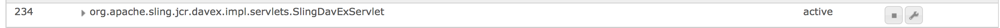

# 在 AEM 中启用 CRXDE Lite{#enabling-crxde-lite-in-aem}

为了确保AEM安装尽可能安全，安全核对清单建议在生产环境中禁用WebDAV[。](/help/sites-administering/security-checklist.md#disable-webdav)

但是，CRXDE Lite依赖于`org.apache.sling.jcr.davex`捆绑包才能正常运行，因此禁用WebDAV也将有效地禁用CRXDE Lite。

发生这种情况时，浏览到`https://serveraddress:4502/crx/de/index.jsp`将显示一个空的根节点，并且对CRXDE Lite资源的所有HTTP请求都将失败：

```xml
404 Resource at '/crx/server/crx.default/jcr:root/.1.json' not found: No resource found
```

虽然此建议旨在尽可能减少攻击面，但系统管理员有时可能需要访问CRXDE Lite来浏览内容或调试生产实例上的问题。

您可以使用[OSGi设置](#enabling-crxde-lite-osgi)或使用[cURL命令](#enabling-crxde-lite-curl)来启用CRXDE Lite。

>[!WARNING]
>
>由于这些方法的操作方式略有不同，您应使用&#x200B;**&#x200B;**&#x200B;**&#x200B; OSGI &#x200B;***或*** cURL。
>
>这两种方法&#x200B;***不能互换***。

## 使用OSGI启用CRXDE Lite {#enabling-crxde-lite-osgi}

如果禁用，则可以通过以下过程启用CRXDE Lite：

1. 转到位于`http://localhost:4502/system/console/components`的OSGi组件控制台
1. 搜索以下组件：

   * `org.apache.sling.jcr.davex.impl.servlets.SlingDavExServlet`

1. 单击其旁边的扳手图标可查看其配置选项：

   

1. 创建以下配置：

   * **根路径：** `/crx/server`
   * 勾选&#x200B;**下方的框使用绝对URI**。

1. 完成使用CRXDE Lite后，请确保再次禁用WebDAV。

## 使用cURL启用CRXDE Lite {#enabling-crxde-lite-curl}

您还可以通过cURL，通过运行（两个）以下两个命令来启用CRXDE Lite：

* 启用`create-absolute-uri` ：

  ```shell
  curl -u admin:admin 'http://localhost:4502/system/console/configMgr/org.apache.sling.jcr.davex.impl.servlets.SlingDavExServlet' --data-raw 'apply=true&action=ajaxConfigManager&%24location=&dav.create-absolute-uri=true&propertylist=dav.create-absolute-uri'
  ```

* 定义`alias`：

  ```shell
  curl -u admin:admin 'http://localhost:4502/system/console/configMgr/org.apache.sling.jcr.davex.impl.servlets.SlingDavExServlet' --data-raw 'apply=true&action=ajaxConfigManager&%24location=&alias=/crx/server&propertylist=alias'
  ```

## 其他资源 {#other-resources}

有关AEM 6安全功能的更多信息，请参阅以下页面：

* [AEM安全核对清单](/help/sites-administering/security-checklist.md)
* [在生产就绪模式下运行 AEM](/help/sites-administering/production-ready.md)
