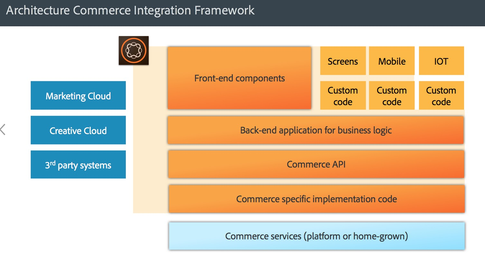
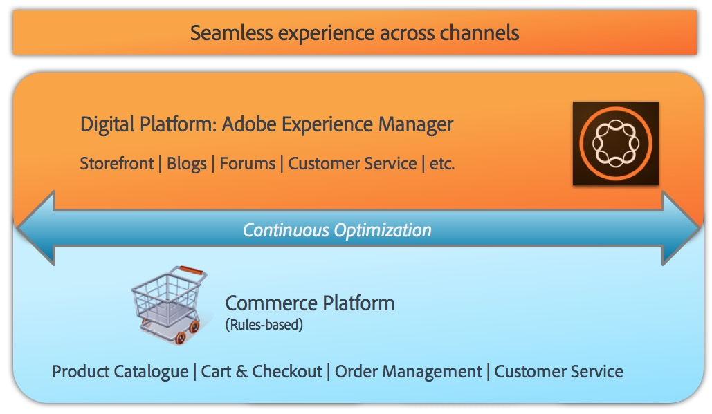

# AEM Commerce - GDPR 就绪{#aem-commerce-gdpr-readiness}

>[!IMPORTANT]
>
>以下章节以 GDPR 为示例进行说明，但其中涵盖的细节同样适用于所有数据保护和隐私法规，例如 GDPR 和 CCPA。

欧盟《通用数据保护条例》关于数据隐私权的规定自 2018 年 5 月起正式生效。 请参阅 [Adobe 隐私中心的 GDPR 页面](https://business.adobe.com/cn/privacy/general-data-protection-regulation.html)。

>[!NOTE]
>
>有关更多详细信息，请参阅 [AEM GDPR 就绪](/help/managing/data-protection-and-privacy.md)。

借助 Adobe 开箱即用的 Commerce 集成，AEM 作为体验层，既可消费服务，又能将数据发送回以 Headless 模式运行的客户商务平台。

对于某些商务平台，Adobe 会在 AEM 中存储轮廓信息（`/home/users`）和商务令牌（用于在商务平台中登录）。 对于这些用例，请阅读[处理 AEM 平台的 GDPR 请求](/help/sites-administering/handling-gdpr-requests-for-aem-platform.md)。

## 处理 AEM Commerce 的 GDPR 请求 {#handling-gdpr-requests-for-aem-commerce}

对于 Salesforce Commerce Cloud 集成，AEM Commerce 不会存储任何与 GDPR 相关的信息。 将请求转发至 [Salesforce 云](https://documentation.b2c.commercecloud.salesforce.com/DOC1/index.jsp)。

对于 hybris 和 HCL WebSphere® Commerce 集成，AEM 中存在一些数据。 使用 [AEM 平台 GDPR 说明](/help/sites-administering/handling-gdpr-requests-for-aem-platform.md)并考虑以下问题：

1. **我的数据存储/使用的位置？** 缓存的用户配置文件信息，例如名称、商业用户标识符、令牌、密码和地址数据，如AEM中所示。
1. **我应该与谁共享包含的GDPR数据？** AEM Commerce中GDPR相关数据的任何更新都不会存储（除了上述相关的用户档案信息之外），而是通过代理传回Commerce平台。
1. **如何删除我的用户数据**？ 在 AEM 中删除用户轮廓，并在商务平台上触发用户删除操作。

>[!NOTE]
>
>如有需要，请参阅 [hybris wiki](https://wiki.hybris.com/) 或 [HCL WebSphere® Commerce 文档](https://help.hcltechsw.com/commerce/index.html)。
