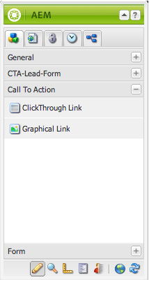
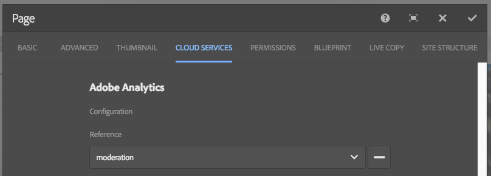

# 将登陆页面与 Adobe Analytics 集成{#integrating-landing-pages-with-adobe-analytics}

AEM已通过使用以下call-to-action (CTA)组件将登陆页面解决方案与[Adobe Analytics](https://www.omniture.com/en/products/analytics/sitecatalyst)集成：

1. 点进组件
1. 图形链接组件

这些组件展示某些可通过Adobe Analytics变量（流量、转化变量）和成功事件映射的属性，以将信息发送到Adobe Analytics。

## 先决条件 {#prerequisites}

Adobe建议您通过[现有AEM-Adobe Analytics集成](/help/sites-administering/adobeanalytics.md)了解此集成的工作方式。

## 可用于映射的组件 {#components-available-for-mapping}

在AEM中，显示在sidekick中的&#x200B;**Call to action**&#x200B;组件（**ClickThroughLink**&#x200B;和&#x200B;**GraphicLink**）可以映射到Adobe Analytics变量。

### 将登陆页面组件映射到Adobe Analytics {#mapping-landing-page-components-to-adobe-analytics}

要将登陆页面组件映射到Adobe Analytics，请执行以下操作：

1. 在创建Adobe Analytics配置并创建框架后，从下拉菜单中选择相应的报表包。 这会导致提取Adobe Analytics变量并在内容查找器中显示它们。
1. 根据需要，将Call to action (CTA)组件从Sidekick拖放到页面中部的映射区域。

<table>
 <tbody>
  <tr>
   <td><strong>组件名称</strong></td>
   <td><strong>公开的属性</strong></td>
   <td><strong>属性的含义</strong></td>
  </tr>
  <tr>
   <td><strong>CTA点进链接</strong></td>
   <td><i>eventdata.clickthroughLinkLabel</i>   </td>
   <td>链接上的标签或链接的文本 </td>
  </tr>
  <tr>
   <td>  </td>
   <td><i>eventdata.clickthroughLinkTarget</i>   </td>
   <td>单击链接时拍摄的目标 </td>
  </tr>
  <tr>
   <td>  </td>
   <td><i>eventdata.events.clickthroughLinkClick</i>   </td>
   <td>点击事件 </td>
  </tr>
  <tr>
   <td><strong>CTA图形链接</strong></td>
   <td><i>eventdata.clickthroughImageLabel</i>   </td>
   <td>CTA图像的标题 </td>
  </tr>
  <tr>
   <td>  </td>
   <td><i>eventdata.clickthroughImageTarget</i>   </td>
   <td>单击包含链接的图像时拍摄的目标</td>
  </tr>
  <tr>
   <td>  </td>
   <td><i>eventdata.clickgroughImageAsset</i>   </td>
   <td>存储库中图像资源的路径 </td>
  </tr>
  <tr>
   <td>  </td>
   <td><i>eventdata.events.clickgroughImageClick</i>   </td>
   <td>点击事件</td>
  </tr>
 </tbody>
</table>

1. 将这些公开的属性与内容查找器中的任何Adobe Analytics变量进行映射。 该框架现在可以使用。
1. 您现在可以创建登陆页面，或使用现有CTA组件打开现有登陆页面，然后从Sidekick中单击&#x200B;**页面属性**&#x200B;中的&#x200B;**云服务**&#x200B;选项卡（在触控优化UI中，选择&#x200B;**打开属性**，然后单击&#x200B;**云服务**），并将框架配置为与登陆页面一起使用。 从下拉列表中选择框架。

   

1. 使用登陆页面配置框架后，您现在可以使用检测出的组件，对CTA的任何点击都记录在Adobe Analytics中。
