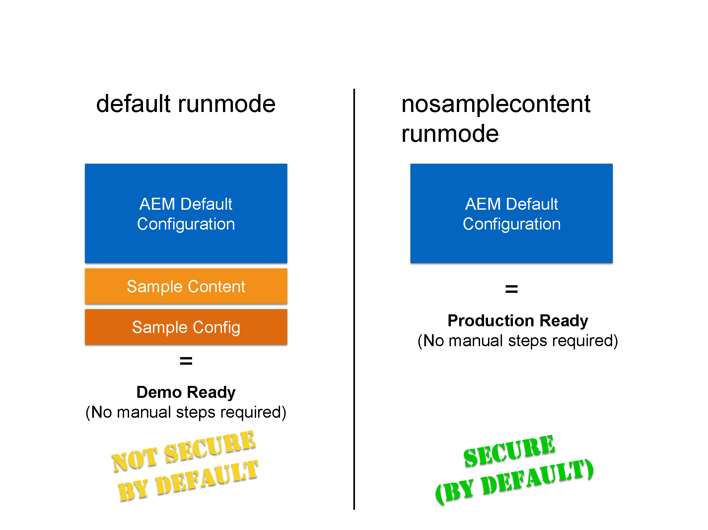

# 在生产就绪模式下运行 AEM{#running-aem-in-production-ready-mode}

在AEM 6.1中，Adobe引入了新的`"nosamplecontent"`运行模式，旨在自动执行准备AEM实例以在生产环境中部署所需的步骤。

新的运行模式不仅会自动配置实例以遵循安全清单中描述的安全最佳实践，还会在此过程中删除所有Geometrixx应用程序和配置示例。

>[!NOTE]
>
>由于实际原因，AEM生产就绪模式将仅涵盖保护实例所需的大多数任务，因此强烈建议您在投入生产环境之前参考[安全核对清单](/help/sites-administering/security-checklist.md)。
>
>另请注意，以生产就绪模式运行AEM将实际禁用对CRXDE Lite的访问。 如果出于调试目的而需要它，请参阅[在AEM中启用CRXDE Lite](/help/sites-administering/enabling-crxde-lite.md)。



要在生产就绪模式下运行AEM，您必须通过`-r`运行模式开关将`nosamplecontent`添加到现有的启动参数：

```shell
java -jar aem-quickstart.jar -r nosamplecontent
```

例如，您可以使用生产就绪启动具有MongoDB持久性的创作实例，如下所示：

```shell
java -jar aem-quickstart.jar -r author,crx3,crx3mongo,nosamplecontent -Doak.mongo.uri=mongodb://remoteserver:27017 -Doak.mongo.db=aem-author
```

## 更改部分生产就绪模式 {#changes-part-of-the-production-ready-mode}

更具体地说，当AEM在生产就绪模式下运行时，将执行以下配置更改：

1. 在生产就绪模式下，**CRXDE支持包** (`com.adobe.granite.crxde-support`)默认处于禁用状态。 可随时从Adobe公共Maven存储库安装它。 AEM 6.1需要版本3.0.0。

1. **Apache Sling Simple WebDAV对存储库** (`org.apache.sling.jcr.webdav`)的访问权限将仅在&#x200B;**作者**&#x200B;实例上可用。

1. 新创建的用户需要在首次登录时更改密码。 这不适用于管理员用户。
1. 已为&#x200B;**Apache Sling JavaScript处理程序**&#x200B;禁用&#x200B;**生成调试信息**。

1. 已为&#x200B;**Apache Sling JSP脚本处理程序**&#x200B;禁用&#x200B;**映射的内容**&#x200B;和&#x200B;**生成调试信息**。

1. **作者**&#x200B;的&#x200B;**Day CQ WCM筛选器**&#x200B;设置为`edit`，在&#x200B;**发布**&#x200B;实例的`disabled`设置为。

1. **Adobe Granite HTML库管理器**&#x200B;配置有以下设置：

   1. **最小化：** `enabled`
   1. **调试：** `disabled`
   1. **Gzip：** `enabled`
   1. **计时：** `disabled`

1. 默认情况下，**Apache Sling GET Servlet**&#x200B;设置为支持安全配置，如下所示：

| **配置** | **作者** | **发布** |
|---|---|---|
| TXT演绎版 | 已禁用 | 已禁用 |
| HTML演绎版 | 已禁用 | 已禁用 |
| JSON演绎版 | 已启用 | 已启用 |
| XML演绎版 | 已禁用 | 已禁用 |
| json.maximumresults | 1000 | 100 |
| 自动索引 | 已禁用 | 已禁用 |
