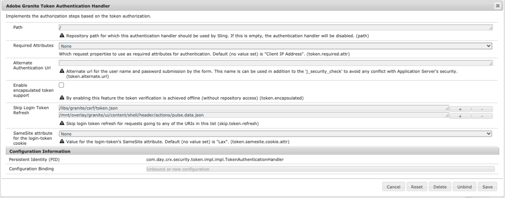

# AEM 6.5支持的相同站点Cookie {#same-site-cookie-support-for-aem-65}

从 80 版开始，Chrome 和后来的 Safari 都引入了一种新的 Cookie 安全模型。 此模式旨在通过名为 `SameSite` 的设置向第三方站点引入有关 Cookie 可用性的安全控制措施。 有关更多详细信息，请参阅此[web.dev - SameSite Cookie说明](https://web.dev/samesite-cookies-explained/)文章。

此设置的默认值 (`SameSite=Lax`) 可能会导致 AEM 实例或服务之间的身份验证不起作用。 这是因为这些服务的域或 URL 结构可能不受此 Cookie 策略的约束。

要解决此问题，您需要将登录令牌的`SameSite` Cookie属性设置为`None`。

>[!CAUTION]
>
>`SameSite=None` 设置仅在协议安全 (HTTPS) 时应用。
>
>如果协议不安全 (HTTP)，则将忽略该设置，服务器将显示以下警告消息：
>
>`WARN com.day.crx.security.token.TokenCookie Skip 'SameSite=None'`

您可以按照以下步骤添加设置：

1. 转至位于 `http://serveraddress:serverport/system/console/configMgr` 的 Web 控制台
1. 搜索找到 **Adobe Granite Token Authentication Handler** 并单击它
1. 将&#x200B;**登录令牌 Cookie 的 SameSite 属性**&#x200B;设置为 `None`，如下图所示
   
1. 单击“保存”
1. 在更新此设置且用户注销并再次登录后，`login-token` Cookie 将具有 `None` 属性集，并且将包含在跨站点请求中。
