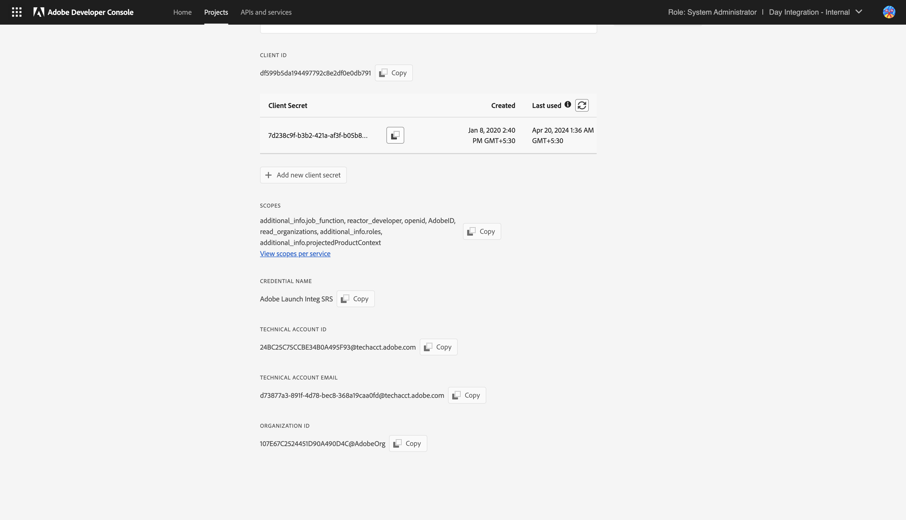

# 为 AEM 设置 IMS 集成 {#setting-up-ims-integrations-for-aem}

>[!NOTE]
>
>Adobe客户使用[Adobe Developer Console](https://developer.adobe.com/console)生成凭据以启用对各种API的访问。 客户可选择从 OAuth 服务器到服务器到单页应用程序的多种凭据类型。 凭据类型服务帐户(JWT)现已弃用，推荐使用Service Pack 20的OAuth服务器到服务器凭据。 此更改可以重新移植到旧版Service Pack，从Service Pack 11开始直到Service Pack 20，并使用您可以[下载](https://experience.adobe.com/#/downloads/content/software-distribution/en/aem.html?package=/content/software-distribution/en/details.html/content/dam/aem/public/adobe/packages/cq650/hotfix/ims-jwt-compatibility-package-6.5-1.0.zip)的修补程序。

Adobe Experience Manager (AEM)可与许多其他Adobe解决方案集成。 例如，Adobe Target、Adobe Analytics 等。

这些集成使用配置了 S2S OAuth 的 IMS 集成。

* 创建后：

  * [Developer Console 中的凭据](#credentials-in-the-developer-console)

* 然后您就可以：

  * 创建（新）[OAuth 配置](#creating-oauth-configuration)

  * [将现有 JWT 配置迁移到 OAuth 配置](#migrating-existing-JWT-configuration-to-oauth)

>[!CAUTION]
>
>以前，使用JWT凭据进行配置，这些凭据现在可在Adobe Developer Console中弃用。
>
>无法再创建或更新此类配置，但可以将它们迁移到 OAuth 配置。

## Developer Console 中的凭据 {#credentials-in-the-developer-console}

第一步，您必须在Adobe Developer Console中配置OAuth凭据。

有关如何执行此配置的详细信息，请参阅Developer Console文档，具体取决于您的要求：

* 概述：

  * [服务器到服务器身份验证](https://developer.adobe.com/developer-console/docs/guides/authentication/ServerToServerAuthentication/)

* 创建新的 OAuth 凭据：

  * [OAuth服务器到服务器凭据实施指南](https://developer.adobe.com/developer-console/docs/guides/authentication/ServerToServerAuthentication/implementation)

* 将现有的 JWT 凭据迁移到 OAuth 凭据：

  * [从服务帐户(JWT)凭据迁移到OAuth服务器到服务器凭据](https://developer.adobe.com/developer-console/docs/guides/authentication/ServerToServerAuthentication/migration)

例如：

## 创建 OAuth 配置 {#creating-oauth-configuration}

要使用 OAuth 创建新的 Adobe IMS 集成：

1. 在 AEM 中，导航到&#x200B;**工具**、**安全**、**Adobe IMS 集成**。

1. 选择&#x200B;**创建**。

1. 根据 [Developer Console](https://developer.adobe.com/developer-console/docs/guides/authentication/ServerToServerAuthentication/implementation) 中的详细信息完成配置。 例如：

   

1. **保存**&#x200B;您的更改。

## 将现有 JWT 配置迁移到 OAuth 配置 {#migrating-existing-JWT-configuration-to-oauth}

要迁移基于 JWT 凭据的现有 Adobe IMS 集成，请执行以下操作：

>[!NOTE]
>
>此示例显示启动 IMS 配置。

1. 在 AEM 中，导航到&#x200B;**工具**、**安全**、**Adobe IMS 集成**。

1. 选择需要迁移的 JWT 配置。 JWT 配置标有 **JWT 凭据（已弃用）**&#x200B;警告。

1. 选择&#x200B;**属性**：

   

1. 该配置将以只读方式打开：

   

1. 从&#x200B;**身份验证类型**&#x200B;下拉菜单中选择 **OAuth**：

   

1. 可用属性已更新。 使用 Developer Console 中的详细信息来完成以下操作：

   

1. 使用&#x200B;**保存并关闭**&#x200B;来保存您的更新。
返回控制台时，**JWT凭据（已弃用）**&#x200B;警告消失。
