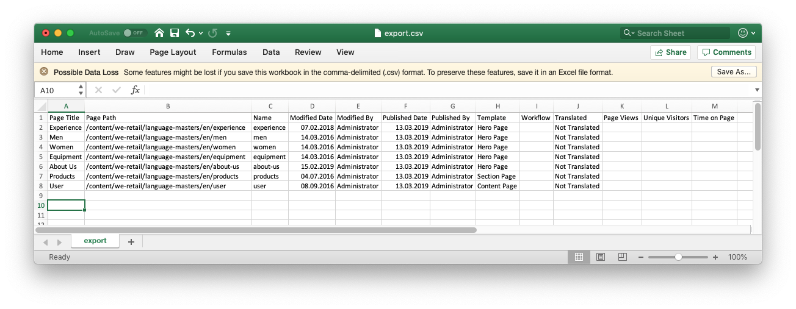
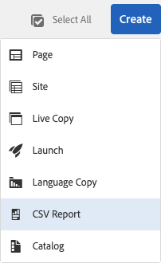
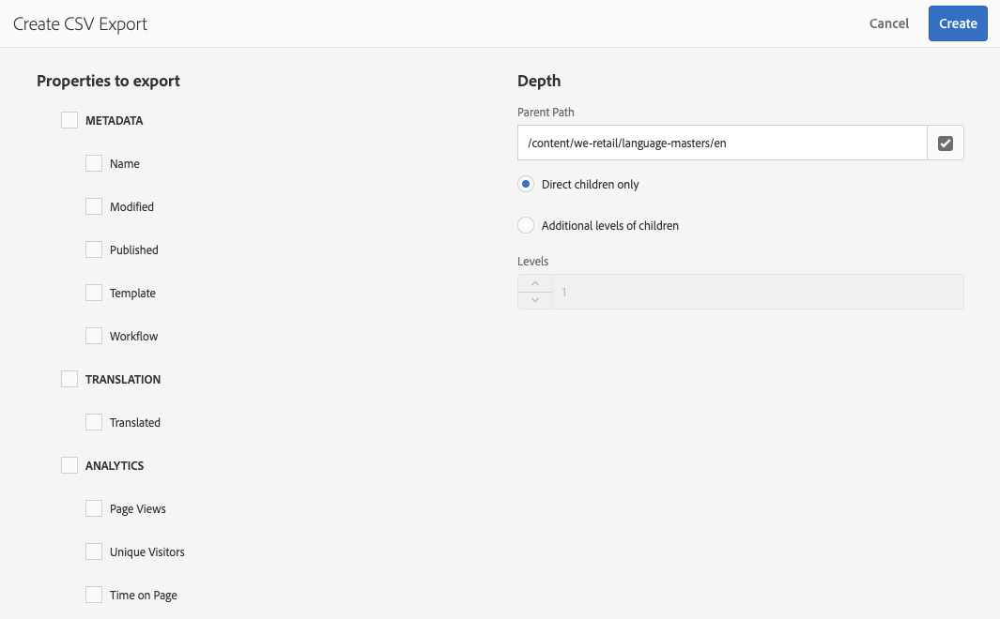

# 导出到 CSV{#export-to-csv}

**创建 CSV 报表**&#x200B;允许您将页面的相关信息导出到本地系统上的 CSV 文件。

* 所下载的文件名为 `export.csv`
* 其内容取决于您选择的属性。
* 您可以定义导出的路径以及深度。

>[!NOTE]
>
>系统将使用您浏览器的下载功能及默认目标位置。

**创建 CSV 导出**&#x200B;向导让您选择以下内容：

* 要导出的属性
  * 元数据
    * 名称
    * 修改时间
    * 发布时间
    * 模板
    * 工作流
  * 翻译
    * 已翻译
  * 分析
    * 页面视图
    * 独特访客
    * 页面停留时间
* 深度
  * 父项路径
  * 仅直接子项
  * 其他级别的子项
  * 级别

生成的 `export.csv` 文件可以用 Excel 或任何其他兼容的应用程序打开。

在浏览&#x200B;**站点**&#x200B;控制台（在“列表”视图中）时，可以使用创建&#x200B;**CSV报告**&#x200B;选项：它是&#x200B;**创建**&#x200B;下拉菜单的一个选项：

要创建 CSV 导出，请执行以下操作：

1. 打开&#x200B;**站点**&#x200B;控制台，根据需要导航到所需的位置。
1. 从工具栏中，选择&#x200B;**创建**，然后选择 **CSV 报表**，以打开向导：

   

1. 选择需要导出的属性。
1. 选择&#x200B;**创建**。
