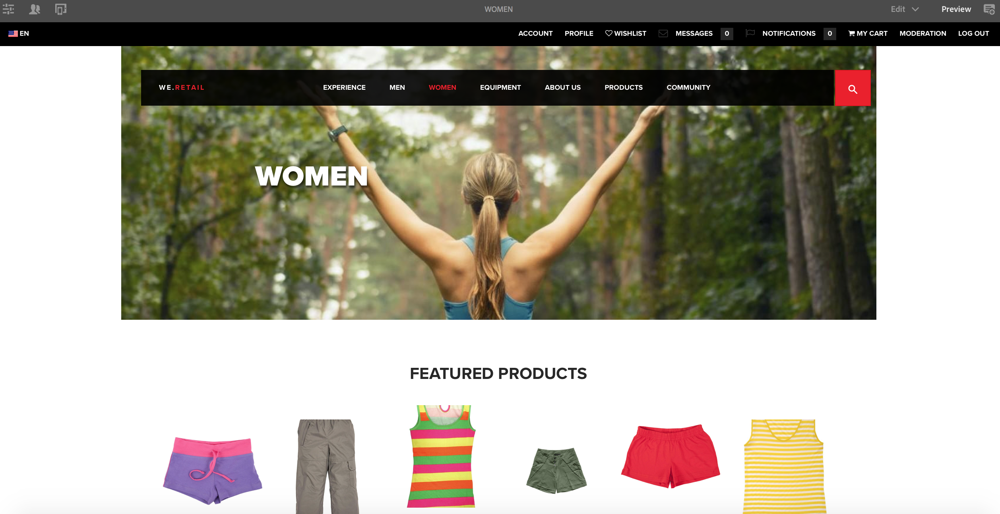

# 创作适用于移动设备的页面{#authoring-a-page-for-mobile-devices}

在创作移动页面时，页面会以模拟移动设备的方式显示。 在创作页面时，您可以在多个模拟器之间切换，以查看最终用户在访问页面时看到的内容。

根据设备呈现页面的功能，设备分为功能、智能和触控三个类别。 当最终用户访问移动页面时，AEM 会检测设备并发送与其设备组对应的演绎版。

>[!NOTE]
>
>要创建基于现有标准站点的移动站点，请创建标准站点的 Live Copy。 （请参阅[为不同的渠道创建Live Copy](/help/sites-administering/msm-livecopy.md)。）
>
>AEM 开发人员可以创建新设备组。 （请参阅[创建设备组筛选器](/help/sites-developing/groupfilters.md)。）

请使用以下过程来创作移动页面：

1. 从全局导航中打开&#x200B;**Sites**&#x200B;控制台。
1. 打开页面&#x200B;**We.Retail** > **美国** > **英语**。

1. 切换到&#x200B;**预览**&#x200B;模式。
1. 单击页面顶部的设备图标以切换到所需的模拟器。
1. 将组件从组件浏览器拖放到页面。

该页面类似于以下内容：

>[!NOTE]
>
>从移动设备中请求创作实例上的页面时，会禁用模拟器。
