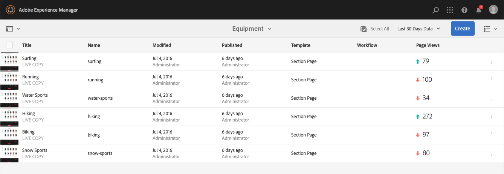
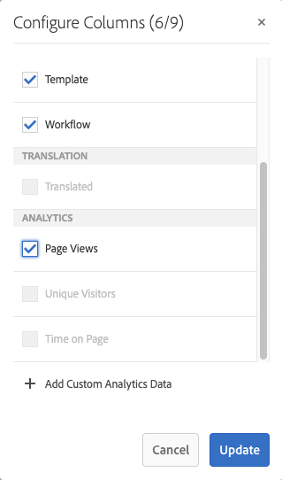
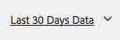
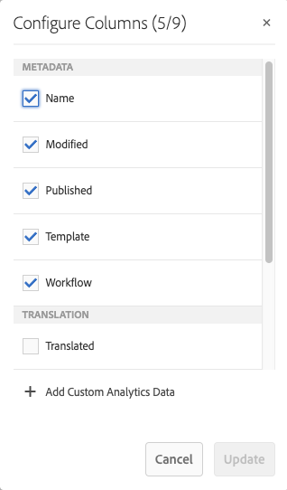
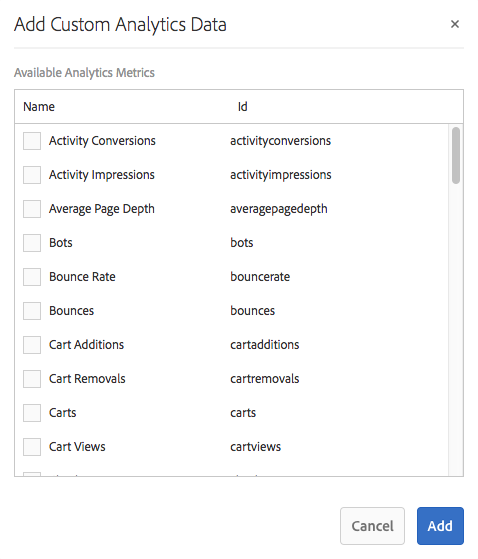

# 请参阅页面分析数据{#seeing-page-analytics-data}

使用页面分析数据来衡量页面内容的有效性。

## Analytics在控制台中可见 {#analytics-visible-from-the-console}

页面分析数据显示在站点控制台的[列表视图](/help/sites-authoring/basic-handling.md#list-view)中。 当页面以列表格式显示时，默认情况下可以使用以下列：

* 页面视图
* 独特访客
* 页面停留时间

每列显示当前报告期的值，并指示该值自上一个报告期以来是增加还是减少。 您看到的数据每12小时更新一次。

>[!NOTE]
>
>要更改更新周期，[配置导入间隔](/help/sites-administering/adobeanalytics-connect.md#configuring-the-import-interval)。

1. 打开&#x200B;**站点**&#x200B;控制台；例如，[https://localhost:4502/sites.html/content](https://localhost:4502/sites.html/content)
1. 在工具栏的最右侧（右上角），单击图标以选择&#x200B;**列表视图** （显示的图标取决于[当前视图](/help/sites-authoring/basic-handling.md#viewing-and-selecting-resources)）。

1. 再次，在工具栏的最右侧（右上角），单击图标，然后选择&#x200B;**查看设置**。 将打开&#x200B;**配置列**&#x200B;对话框。 进行所需的任何更改并通过&#x200B;**更新**&#x200B;确认。

   

### 选择报告周期 {#selecting-the-reporting-period}

选择站点控制台上显示Analytics数据的报告时段：

* 过去 30 天的数据
* 过去 90 天的数据
* 本年度的数据

当前报告时段显示在站点控制台的工具栏上（顶部工具栏的右侧）。 使用下拉菜单选择所需的报告时段。

### 配置可用数据列 {#configuring-available-data-columns}

analytics-administrators用户组的成员可以配置Sites控制台，以便作者能够查看额外的Analytics列。

>[!NOTE]
>
>当页面树包含与不同Adobe Analytics云配置关联的子项时，无法为页面配置可用数据列。

1. 在“列表视图”中，使用视图选择器（工具栏的右侧），选择&#x200B;**视图设置**，然后选择&#x200B;**添加自定义分析数据**。

   

1. 在Sites控制台中选择要向作者公开的量度，然后单击&#x200B;**添加**。

   显示的列是从Adobe Analytics中检索的。

   

### 从站点打开内容分析 {#opening-content-insights-from-sites}

从站点控制台打开[内容Insight](/help/sites-authoring/content-insights.md)以进一步调查页面有效性。

1. 在站点控制台中，选择要查看其内容分析的页面。
1. 在工具栏上，单击Analytics和“推荐”图标。

   

## 在页面编辑器(Activity Map)中可见Analytics {#analytics-visible-from-the-page-editor-activity-map}

>[!CAUTION]
>
>由于 Adobe Analytics API 的安全性更改，AEM 内置的 Activity Map 版本已无法继续使用。
>
>现在应使用Adobe Analytics[&#128279;](https://experienceleague.adobe.com/docs/analytics/analyze/activity-map/getting-started/get-started-users/activitymap-install.html)提供的ActivityMap插件。
