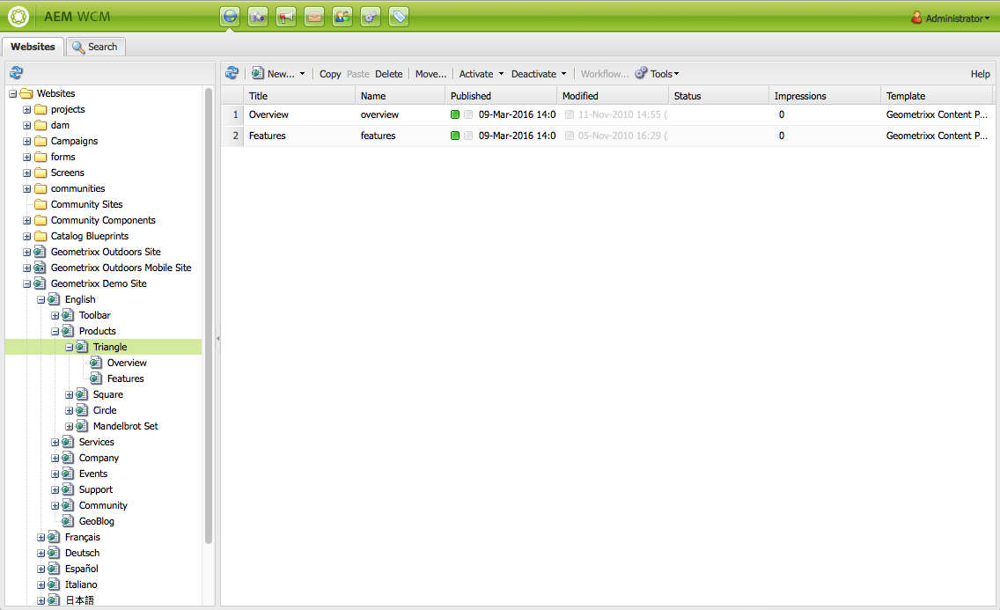
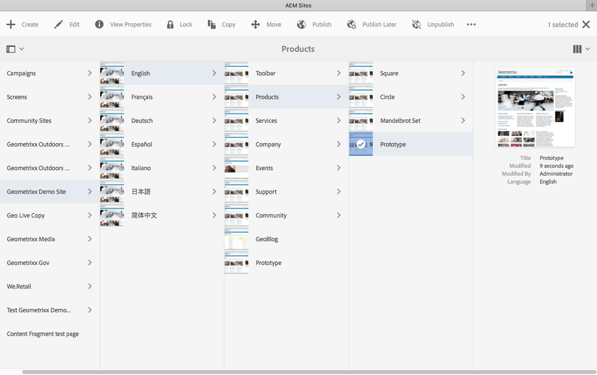
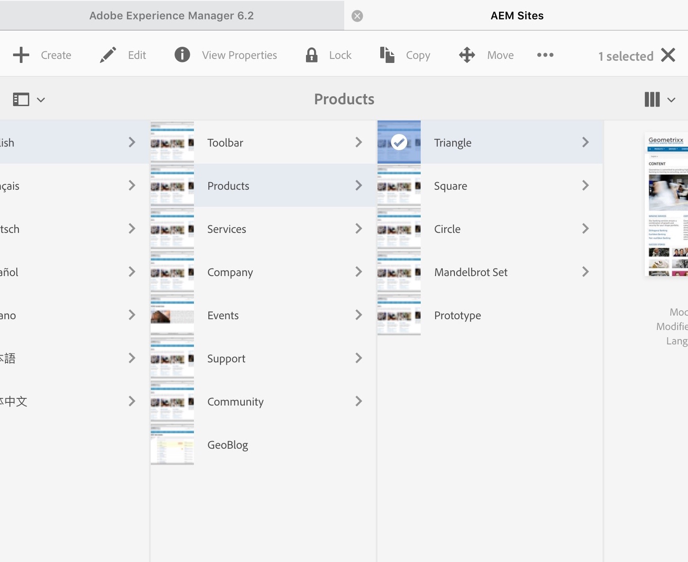

# 使用创作环境{#working-with-the-author-environment}

>[!NOTE]
>
>以下文档侧重于经典UI。 有关在启用了触屏的现代UI中进行创作的信息，请参阅[标准创作文档](/help/assets/assets.md)。

通过创作环境，您可以执行与以下相关的任务：

* [创作](/help/sites-authoring/author.md)（包括[页面创作](/help/sites-authoring/qg-page-authoring.md)和[管理资源](/help/assets/assets.md)）

* 在网站上生成和维护内容时，需要[管理](/help/sites-administering/administer-best-practices.md)任务

提供了两个图形用户界面来实现这一点，它们可以通过任何现代浏览器访问：

1. 经典 UI

   * 此UI在AEM中始终可用已有多年。
   * 它主要是绿色的。
   * 它设计为可在桌面设备上使用。
   * 它不再被维护。
   * 以下文档重点介绍此经典UI。 有关使用现代触控UI进行创作的信息，请参阅[标准创作文档](/help/sites-authoring/author.md)。

   

1. 触屏优化UI

   * 这是现代的标准AEM UI。
   * 它以灰色为主，界面整洁、平整。
   * 它专为触控和桌面设备而设计（针对触控而优化）。 所有设备上的外观和感觉都相同，但[查看和选择您的资源](/help/sites-authoring/basic-handling.md)略有不同（点击次数与点击次数）。
   * 有关如何使用基于触摸的UI进行创作的更多详细信息，请参阅[标准创作文档](/help/sites-authoring/author.md)。 以下文档侧重于经典UI。

   * 桌面：

   

   * 平板电脑设备（或宽度小于1024像素的台式机）：

   
